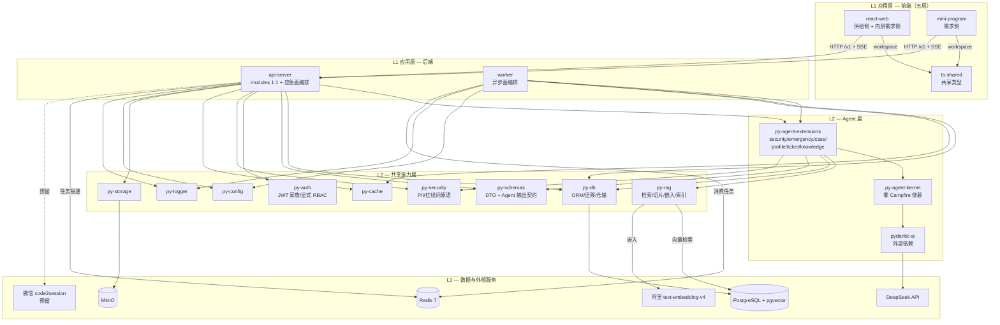

# 项目结构 · 层间数据流与依赖

> **本文唯一拥有**：端到端层间数据流场景与模块间依赖关系。
> 所属文档组：项目结构。机制语义（时刻分层、兜底信号、绑定合并等）的唯一权威归机制文档，本文仅描述层间流转。

## 一、场景一：应急咨询（时刻分层 + SSE 流式）

```
家属点选行为桶（可附文字）
       │
       ▼
┌──────────────────┐  POST /api/v1/consult/stream (SSE)   ┌──────────────────────────┐
│  mini-program /  │ ─────────────────────────────────────►│  api-server               │
│  react-web（内测）│                                       │  modules/emergency/       │
│                  │  view → viewModel(useConsult)         │   routes.py → service     │
│  viewModel 编排： │   → infrastructure/consultRepository │                           │
│   发起流式请求    │   → 消费事件流 → store 更新           │  ① crisis 模块红线判定     │──► py_security.redline
│                  │                                       │     ├─ 命中 → 高危桶卡      │──► 直接响应（零 LLM）
│                  │                                       │     └─ 未命中 ↓            │
│                  │                                       │  ② crisis 此刻安全层       │──► 通用卡→桶卡→阶段卡
│                  │                                       │  ③ 编排代码并行预取         │──► profile_get / rag_search
│                  │                                       │     （扩展工具实现，直调）    │    （py_agent_extensions）
│                  │                                       │  ④ 预注入 + 强制加载 Skill  │──► kernel skill-loader
│                  │                                       │  ⑤ 内核单轮 Agent 生成      │──► py-agent-kernel
│                  │                                       │     （security 扩展经事件    │    → pydantic-ai
│                  │                                       │      总线挂载：免责声明/     │    → DeepSeek
│                  │                                       │      输出契约校验）          │
│                  │                                       │  ⑥ 输出契约校验            │──► py_schemas.agent（四段式）
│                  │◄── SSE Token Stream ──────────────────│  ⑦ 追问轮：放行 rag_search │──► FilteredToolset 白名单
│                  │                                       │  ⑧ 确定性兜底信号后校验     │──► ticket_create（M4 后）
└──────────────────┘                                       └──────────────────────────┘
```

数据形态变化：

```text
桶选择 + 文字 (Props) [view]
  → useConsult 调用 [viewModel]
  → ConsultRequest (py_schemas.consult) [api-server 接口层]
  → 红线判定结果 / 安全卡 (crisis 模块，py_security 规则) [代码层]
  → Profile 实体 (py_db.models.profiles) + CaseChunk 列表 (py_rag.retrieval)
  → 预注入上下文 + Skill 指令 (kernel Session/消息模型)
  → 四段式方案 (py_schemas.agent，契约校验)
  → SSE chunk 流 (core/streaming → text/event-stream)
  → store 状态 [viewModel] → Props [view] → 渲染
  → Consultation 会话落库 (py_db) + Optional Ticket 实体
```

## 二、场景二：案例 Agent 化生产与异步索引

```
老师在 react-web 提交 L1 叙事
       │
       ▼
┌──────────────────┐  POST /api/v1/cases                  ┌──────────────────────────┐
│  react-web        │ ─────────────────────────────────────►│  api-server               │
│  view → viewModel │                                       │  modules/cases/           │
│   → infrastructure│                                       │   ① Pydantic 校验          │──► py_schemas.cases
│                  │◄── 201 Created ───────────────────────│   ② 元数据落库             │──► py_db.repositories
│                  │                                       │   ③ 投递提取任务           │──► py_cache Redis 队列
└──────────────────┘                                       └───────────┬──────────────┘
                                                                        │ Redis Queue
                                                                        ▼
                                                            ┌──────────────────────────┐
                                                            │  worker（异步面）          │
                                                            │  tasks/case_extraction    │
                                                            │   ① 消费任务 → 装配异步面   │──► agent_bootstrap
                                                            │   ② 内核 Agent 自主执行     │──► py-agent-kernel
                                                            │      case-extraction Skill│    （security 首位：PII
                                                            │   ③ 工具链：pii_scan →     │     脱敏建议经 tool_result）
                                                            │      ebp_suggest           │──► py_agent_extensions
                                                            │   ④ L2 卡片契约校验        │──► py_schemas.agent
                                                            │   ⑤ 结果落库待专家终审      │──► py_db
                                                            │                                                           
                                                            │  终审通过后（api-server 触发）│
                                                            │  tasks/case_indexing      │
                                                            │   ⑥ 切片 → 嵌入 → pgvector │──► py_rag（splitters/
                                                            │      写入 → 状态扭转已索引  │     embedding/indexing）
                                                            │  失败语义：重试 ≤3 次，     │
                                                            │  最终失败落库标记 + 通知    │
                                                            └──────────────────────────┘
```

## 三、场景三：认证与授权（身份-凭证分离，ADR-013）

```
内测用户登录（react-web）
       │
       ▼
┌──────────────────┐  POST /api/v1/auth/login              ┌──────────────────────────┐
│  react-web        │  {phone, password}                    │  api-server               │
│  view 登录页      │ ─────────────────────────────────────►│  modules/auth/            │
│   → viewModel     │                                       │   ① 按 phone 查 User       │──► py_db.repositories
│     (useAuth)     │                                       │   ② 取 password Credential │──► credentials 表
│                  │                                       │   ③ bcrypt 校验            │──► py_auth.hashing
│                  │                                       │   ④ status 检查（disabled   │
│                  │                                       │      拒绝；pending_review    │
│                  │                                       │      仅见审核页）            │
│                  │                                       │   ⑤ 签发 Token 家族         │──► py_auth.jwt_utils
│                  │◄── 200 {access, refresh} ─────────────│     （family_id 建立）      │
│  infrastructure/  │                                       │                           │
│   http/tokenManager│                                      │  [后续请求]                │
│   存储与自动注入    │  GET /api/v1/profiles/{id}            │  core/dependencies/        │
│                  │  Authorization: Bearer <AT>            │   get_current_user（验签    │──► py_auth.jwt_utils
│  [AT 过期]        │ ─────────────────────────────────────►│   + status 校验）           │
│  401 拦截 →       │                                       │   require_roles（显式       │──► py_auth.rbac
│  POST /auth/refresh│                                      │   角色→能力映射）           │
│  旧 refresh 单次   │◄── 403 越权 / 200 数据 ──────────────│                           │
│  使用 + 轮换；     │                                       │  [续期] 旧 refresh 已用     │
│  复用 → 全家族吊销 │◄── 401 强制重登 ─────────────────────│  标记；再次出示 → 家族吊销  │──► py_auth.blacklist
└──────────────────┘                                       └──────────────────────────┘
```

**预留流程**（微信开放平台认证完成后，ADR-013）：mini-program `wx.login` → infrastructure/wechat → `code2session` → unionid/openid 查 wechat Credential → 已绑定直接签发（静默登录）；未绑定 → 手机号 + 短信验证码 → 命中 User 则创建 Credential 合并，未命中注册新 User（family/volunteer）。

## 四、模块间依赖关系（Mermaid）



**依赖规则要点**：

1. 前端经 HTTP/SSE 调用 api-server，绝不直连数据库、向量库或外部 API；
2. api-server 与 worker 经 Redis 队列解耦，禁止应用间直接 import 或 RPC；
3. **内核零领域知识**：`py-agent-kernel` 不依赖任何 Campfire 包；扩展 → 内核 → pydantic-ai 单向；
4. 扩展可消费 py-rag / py-db / py-schemas / py-security 实现工具，扩展间零 import；
5. security 扩展在 api-server 与 worker 的启动装配中均位于加载清单首位，附启动断言（缺失即拒绝启动）；
6. `py-db` ORM 与 Alembic 迁移是数据库 schema 单一真相来源；`py-schemas` 是前后端契约与 Agent 输出契约的权威，前端 `ts-shared` 与之对齐；
7. 循环依赖由 uv / pnpm workspace 构建期检测。
