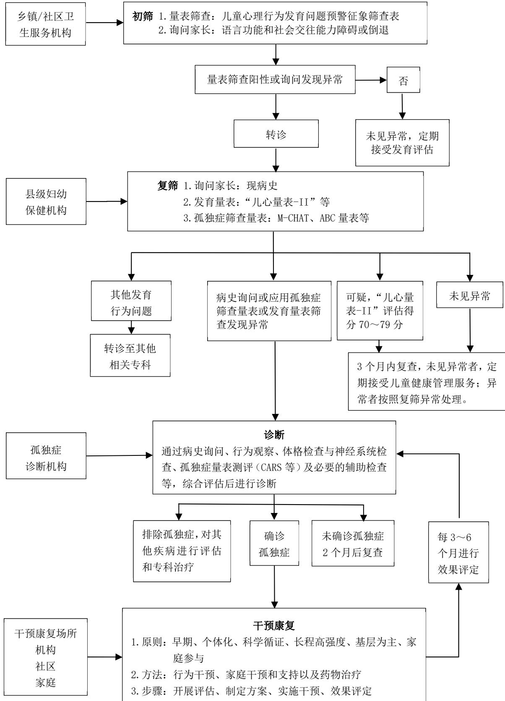

<!-- p1 -->

主管：中华人民共和国国家卫生健康委员会主办：国家卫生健康委员会办公厅承办：中国健康教育中心出版：《中华人民共和国国家卫生健康委员会公报》编辑部编辑：《中华人民共和国国家卫生健康委员会公报》编辑部通讯地址：北京市安定门外安华西里一区12 号楼邮政编码：100011电话：010-64260328印刷厂：人卫印务（北京）有限公司邮编：100021

中国标准连续出版物

国际标准刊号：ISSN 1672-5417

国内统一刊号：CN 10-1503/D

2022年第8期（总号：226）

目录

国家卫生健康委员会公告（2022年 第4号）…国家卫生健康委办公厅关于印发0～6岁儿童孤独症筛查干预服务规范（试行）的通知（国卫办妇幼发〔2022〕12号）4国家卫生健康委关于印发“十四五”卫生健康人才发展规划的通知（国卫人发〔2022〕27号）27国家卫生健康委关于印发食品安全标准与监测评估“十四五”规划的通知（国卫食品发〔2022〕28号）35关于印发医疗卫生机构网络安全管理办法的通知（国卫规划发2022〕29 号）42国家疾控局发布2022年8月全国法定传染病疫情概况 ……… 47

<!-- p2 -->

GAZETTEOFTHENATIONALHEALTHCOMMISSIONOFTHEPEOPLE’SREPUBLICOFCHINA

2022 Issue No. 8 (Serial No.226)

CONTENTS

Announcement No.4, 2022 of the National Health Commission …Circular of the General Office of the National Health Commission on Issuing the Protocol forAutism Screening and Intervention Services for Children Aged 0-6 Years(Trial) ………… 4Circular of the National Health Commission on Issuing the 14th Five-Year Health PersonnelDevelopment Plan……27Circular of the National Health Commission on Issuing the 14th Five-Year Plan for FoodSafety Standards, Monitoring and Evaluation35Circular on Issuing the Administrative Measures for Cybersecurity of Medical and HealthInstitutions…42The National Bureau of Disease Control and Prevention Released The Epidemic Situationof Statutory Reporting Infectious Diseases of August, 2022…47

<!-- p3 -->

## 国家卫生健康委员会公告

2022年 第4号

根据《中华人民共和国食品安全法》及其实施条例有关规定，为进一步规范《可用于食品的菌种名单》和《可用于婴幼儿食品的菌种名单》管理，审评机构组织专家对两个菌种名单进行了更新。对名单中涉及菌种分类和命名调整的，设置2年过渡期。

特此公告。

附件：1.可用于食品的菌种名单

2.可用于婴幼儿食品的菌种名单

国家卫生健康委

2022年8月18日

### 附件1

可用于食品的菌种名单

**表 p3-b10-l0-s0**

| 编号 | 更新后的菌种名称 | 更新后的菌种名称 | 原用菌种名称 | 原用菌种名称 |
|---|---|---|---|---|
| 编号 | 菌种 | 拉丁名称 | 菌种 | 拉丁名称 |
| 一 | 双歧杆菌属 | Bifidobacterium | 双歧杆菌属 | Bifidobacterium |
| 1 | 青春双歧杆菌 | Bifidobacterium adolescentis | 青春双歧杆菌 | Bifidobacterium adolescentis |
| 2 | 动物双歧杆菌 动物亚种 | Bifidobacterium animalis subsp. animalis | 动物双歧杆菌 （乳双歧杆菌） | Bifidobacterium animalis （Bifidobacterium lactis） |
| 3 | 动物双歧杆菌 乳亚种 | Bifidobacterium animalis subsp.lactis | 动物双歧杆菌 （乳双歧杆菌） | Bifidobacterium animalis （Bifidobacterium lactis） |
| 4 | 两歧双歧杆菌 | Bifidobacterium bifidum | 两歧双歧杆菌 | Bifidobacterium bifidum |
| 5 | 短双歧杆菌 | Bifidobacterium breve | 短双歧杆菌 | Bifidobacterium breve |
| 6 | 长双歧杆菌长 亚种 | Bifidobacterium longum subsp.longum | 长双歧杆菌 | Bifidobacterium longum |
| 7 | 长双歧杆菌婴 儿亚种 | Bifidobacterium longum subsp. infantis | 婴儿双歧杆菌 | Bifidobacterium infantis |
| 二 | 乳杆菌属 | Lactobacillus | 乳杆菌属 | Lactobacillus |
| 1 | 嗜酸乳杆菌 | Lactobacillus acidophilus | 嗜酸乳杆菌 | Lactobacillus acidophilus |
| 2 | 卷曲乳杆菌 | Lactobacillus crispatus | 卷曲乳杆菌 | Lactobacillus crispatus |

<!-- p4 -->

国家卫生健康委员会公报 2022·08

**表 p4-b0-l1-s0**

| 3 | 德氏乳杆菌保 加利亚亚种 | Lactobacillus delbrueckii subsp. bulgaricus | 德氏乳杆菌保加 利亚亚种（保加 利亚乳杆菌） | Lactobacillus delbrueckii subsp. bulgaricus |
|---|---|---|---|---|
| 4 | 德氏乳杆菌乳 亚种 | Lactobacillus delbrueckii subsp. lactis | 德氏乳杆菌乳 亚种 | Lactobacillus delbrueckii subsp. lactis |
| 5 | 格氏乳杆菌 | Lactobacillus gasseri | 格氏乳杆菌 | Lactobacillus gasseri |
| 6 | 瑞士乳杆菌 | Lactobacillus helveticus | 瑞士乳杆菌 | Lactobacillus helveticus |
| 7 | 约氏乳杆菌 | Lactobacillus johnsonii | 约氏乳杆菌 | Lactobacillus johnsonii |
| 8 | 马乳酒样乳杆 菌马乳酒样亚 种 | Lactobacillus kefiranofaciens subsp. kefiranofaciens | 马乳酒样乳杆 菌马乳酒样亚 种 | Lactobacillus kefiranofaciens subsp. kefiranofaciens |
| 三 | 乳酪杆菌属 | Lacticaseibacillus | 乳杆菌属 | Lactobacillus |
| 1 | 干酪乳酪杆菌 | Lacticaseibacillus casei | 干酪乳杆菌 | Lactobacillus casei |
| 2 | 副干酪乳酪杆 菌 | Lacticaseibacillus paracasei | 副干酪乳杆菌 | Lactobacillus paracasei |
| 3 | 鼠李糖乳酪杆 菌 | Lacticaseibacillus rhamnosus | 鼠李糖乳杆菌 | Lactobacillus rhamnosus |
| 四 | 粘液乳杆菌属 | Limosilactobacillus | 乳杆菌属 | Lactobacillus |
| 1 | 发酵粘液乳杆 菌 | Limosilactobacillus fermentum | 发酵乳杆菌 | Lactobacillus fermentum |
| 2 | 罗伊氏粘液乳 杆菌 | Limosilactobacillus reuteri | 罗伊氏乳杆菌 | Lactobacillus reuteri |
| 五 | 乳植杆菌属 | Lactiplantibacillus | 乳杆菌属 | Lactobacillus |
| 1 | 植物乳植杆菌 | Lactiplantibacillus plantarum | 植物乳杆菌 | Lactobacillus plantarum |
| 六 | 联合乳杆菌属 | Ligilactobacillus | 乳杆菌属 | Lactobacillus |
| 1 | 唾液联合乳杆 菌 | Ligilactobacillus salivarius | 唾液乳杆菌 | Lactobacillus salivarius |
| 七 | 广布乳杆菌属 | Latilactobacillus | 乳杆菌属 | Lactobacillus |
| 1 | 弯曲广布乳杆 菌 | Latilactobacillus curvatus | 弯曲乳杆菌 | Lactobacillus curvatus |
| 2 | 清酒广布乳杆 菌 | Latilactobacillus sakei | 清酒乳杆菌 | Lactobacillus sakei |
| 八 | 链球菌属 | Streptococcus | 链球菌属 | Streptococcus |
| 1 | 唾液链球菌嗜 热亚种 | Streptococcus salivarius subsp. thermophilus | 嗜热链球菌 | Streptococcus thermophilus |
| 九 | 乳球菌属 | Lactococcus | 乳球菌属 | Lactococcus |
| 1 | 乳酸乳球菌乳 亚种 | Lactococcus lactis subsp. lactis | 乳酸乳球菌乳酸 亚种 | Lactococcus lactis subsp. lactis |
| 2 | 乳酸乳球菌乳 亚种（双乙酰 型） | Lactococcus lactis subsp. lactis biovar diacetylactis | 乳酸乳球菌双乙 酰亚种 | Lactococcus lactis subsp. diacetylactis |
| 3 | 乳脂乳球菌 | Lactococcus cremoris | 乳酸乳球菌乳脂 亚种 | Lactococcus lactis subsp. cremoris |
| 十 | 丙酸杆菌属 | Propionibacterium | 丙酸杆菌属 | Propionibacterium |
| 1 | 费氏丙酸杆菌 谢氏亚种 | Propionibacterium freudenreichii subsp. shermanii | 费氏丙酸杆菌 谢氏亚种 | Propionibacterium freudenreichii subsp. shermanii |
| 十一 | 丙酸菌属 | Acidipropionibacterium | 丙酸杆菌属 | Propionibacterium |
| 1 | 产丙酸丙酸菌 | Acidipropionibacterium acidipropionici | 产丙酸丙酸杆菌 | Propionibacterium acidipropionici |
| 十二 | 明串珠菌属 | Leuconostoc | 明串珠菌属 | Leuconostoc |
| 1 | 肠膜明串珠菌 肠膜亚种 | Leuconostoc mesenteroides subsp. mesenteroides | 肠膜明串珠菌 肠膜亚种 | Leuconostoc mesenteroides subsp. mesenteroides |
| 十三 | 片球菌属 | Pediococcus | 片球菌属 | Pediococcus |
| 1 | 乳酸片球菌 | Pediococcus acidilactici | 乳酸片球菌 | Pediococcus acidilactici |
| 2 | 戊糖片球菌 | Pediococcus pentosaceus | 戊糖片球菌 | Pediococcus pentosaceus |
| 十四 | 魏茨曼氏菌属 | Weizmannia | 芽孢杆菌属 | Bacillus |
| 1 | 凝结魏茨曼氏 菌 | Weizmannia coagulans | 凝结芽孢杆菌 | Bacillus coagulans |
| 十五 | 动物球菌属 | Mammaliicoccus | 葡萄球菌属 | Staphylococcus |
| 1 | 小牛动物球菌 | Mammaliicoccus vitulinus | 小牛葡萄球菌 | Staphylococcus vitulinus |
| 十六 | 葡萄球菌属 | Staphylococcus | 葡萄球菌属 | Staphylococcus |
| 1 | 木糖葡萄球菌 | Staphylococcus xylosus | 木糖葡萄球菌 | Staphylococcus xylosus |
| 2 | 肉葡萄球菌 | Staphylococcus carnosus | 肉葡萄球菌 | Staphylococcus carnosus |
| 十七 | 克鲁维酵母属 | Kluyveromyces | 克鲁维酵母属 | Kluyveromyces |
| 1 | 马克斯克鲁维 酵母 | Kluyveromyces marxianus | 马克斯克鲁维 酵母 | Kluyveromyces marxianus |

注：1.传统上用于食品生产加工的菌种允许继续使用。名单以外的、新菌种按照《新食品原料安全性审查管理办法》执行。2.用于婴幼儿食品的菌种按《可用于婴幼儿食品的菌种名单》执行。3.2010年后公告、增补入《可用于食品的菌种名单》的菌种，使用范围应符合原公告内容。

<!-- p5 -->

### 附件2

可用于婴幼儿食品的菌种名单

**表 p5-b3-l0-s0**

| 编号 | 更新后的菌种名称 | 更新后的菌种名称 | 原用菌种名称 | 原用菌种名称 |
|---|---|---|---|---|
| 编号 | 菌株 | 拉丁名称 | 菌株 | 拉丁名称 |
| 1 | 嗜酸乳杆菌NCFM | Lactobacillus acidophilus NCFM | 嗜酸乳杆菌NCFM | Lactobacillus acidophilus NCFM |
| 2 | 动物双歧杆菌乳亚 种Bb-12 | Bifidobacterium animalis subsp. lactis Bb-12 | 动物双歧杆菌Bb-12 | Bifidobacterium animalis Bb-12 |
| 3 | 动物双歧杆菌乳亚 种HN019 | Bifidobacterium animalis subsp. lactis HN019 | 乳双歧杆菌HN019 | Bifidobacterium lactis HN019 |

<!-- p6 -->

国家卫生健康委员会公报 2022·08

**表 p6-b0-l1-s0**

| 编号 | 更新后的菌种名称 | 更新后的菌种名称 | 原用菌种名称 | 原用菌种名称 |
|---|---|---|---|---|
| 编号 | 菌株 | 拉丁名称 | 菌株 | 拉丁名称 |
| 4 | 动物双歧杆菌乳亚 种Bi-07 | Bifidobacterium animalis subsp. lactis Bi-07 | 乳双歧杆菌Bi-07 | Bifidobacterium lactis Bi-07 |
| 5 | 鼠李糖乳酪杆菌GG | Lacticaseibacillus rhamnosus GG | 鼠李糖乳杆菌LGG | Lactobacillus rhamnosus LGG |
| 6 | 鼠李糖乳酪杆菌 HN001 | Lacticaseibacillus rhamnosus HN001 | 鼠糖糖乳杆菌HN001 | Lactobacillus rhamnosus HN001 |
| 7 | 鼠李糖乳酪杆菌 MP108 | Lacticaseibacillus rhamnosus MP108 | 鼠李糖乳杆菌MP108 | Lactobacillus rhamnosus MP108 |
| 8 | 罗伊氏粘液乳杆菌 DSM 17938 | Limosilactobacillus reuteri DSM 17938 | 罗伊氏乳杆菌 DSM 17938 | Lactobacillus reuteri DSM 17938 |
| 9 | 发酵粘液乳杆菌 CECT 15716 | Limosilactobacillus fermentum CECT 5716 | 发酵乳杆菌 CECT 5716 | Lactobacillus fermentum CECT 5716 |
| 10 | 短双歧杆菌M-16V | Bifidobacterium breve M-16V | 短双歧杆菌M-16V | Bifidobacterium breve M-16V |
| 11 | 瑞士乳杆菌R0052 | Lactobacillus helveticus R0052 | 瑞士乳杆菌RO052 | Lactobacillus helveticus R0052 |
| 12 | 长双歧杆菌婴儿亚 种R0033 | Bifidobacterium longum subsp. infantis R0033 | 婴儿双歧杆菌R0033 | Bifidobacterium infantis R0033 |
| 13 | 两歧双歧杆菌 R0071 | Bifidobacterium bifidum R0071 | 两旋双歧杆菌R0071 | Bifidobacterium bifidum R0071 |
| 14 | 长双歧杆菌长亚种 BB536 | Bifidobacterium longum subsp. longum BB536 | 长双歧杆菌长亚种 BB536 | Bifidobacterium longum subsp. longum BB536 |

*仅限用于1岁以上幼儿的食品

国家卫生健康委办公厅关于印发0～6岁儿童孤独症筛查干预服务规范（试行）的通知

国卫办妇幼发〔2022〕12号

各省、自治区、直辖市及新疆生产建设兵团卫生健康委：

为规范0～6岁儿童孤独症筛查、诊断和干预服务，促进儿童健康，我委组织制定了《0～6岁儿童孤独症筛查干预服务规范（试行）》（可从国家卫生健康委官方网站下载）。现印发给你们，请参照执行。

国家卫生健康委办公厅

2022年8月23日

<!-- p7 -->

0～6岁儿童孤独症筛查干预服务规范

（试行）

孤独症谱系障碍（也称自闭症，以下简称孤独症）是一类发生于儿童早期的神经发育障碍性疾病，以社交沟通障碍、兴趣狭隘、行为重复刻板为主要特征，严重影响儿童社会功能和生活质量。我国儿童孤独症患病率约为7‰,严重危害儿童健康和家庭幸福。孤独症通常起病于婴幼儿期，目前尚缺乏有效治疗药物，主要治疗途径为康复训练，最佳治疗期为6岁前，越早干预效果越好。通过早期发现、早期诊断、早期干预可不同程度改善患儿症状和预后。为规范儿童孤独症筛查、诊断和干预服务，促进儿童健康，制定本规范。

## 一、服务对象

辖区内常住的0～6岁儿童。

## 二、服务目的

（一）面向社会公众开展科普宣传，形成全社会关心关爱孤独症儿童及家庭的良好社会氛围。

（二）针对目标人群加强健康教育，提高儿童家长孤独症科普知识知晓率，增强家长接受筛查、诊断和干预服务的主动性和积极性。

（三）规范儿童孤独症筛查、诊断、干预康复服务，提升干预效果，减少精神残疾发生，促进儿童健康。

## 三、服务内容

包括健康教育、筛查、诊断、干预康复等4部分内容。

（一）健康教育。

通过多种方式，向社会公众和儿童家长普及孤独症基本知识，宣传筛查、诊断、干预措施，提高科学知识知晓率。引导家长树立儿童健康第一责任人意识，积极主动接受孤独症筛查、诊断和干预服务。

（二）筛查。

1.初筛。乡镇卫生院、社区卫生服务中心等基层医疗卫生机构承担初筛服务。结合国家基本公共卫生服务0～6岁儿童健康管理项目的服务时间和频次，通过应用“儿童心理行为发育问题预警征象筛查表”等方法（即《国家基本公共卫生服务规范》0～6岁儿童健康管理服务规范中发育评估相关内容），为0～6岁儿童提供11次心理行为发育初筛服务。

（1）初筛时间。1岁以内婴儿期4次，分别在3、6、8、12月龄时；1至3岁幼儿期4次，分别在18、24、30、36月龄时；学龄前期3次，分别在4、5、6岁时。

（2）初筛工具。“儿童心理行为发育问题预警征象筛查表”（附件1）。

（3）初筛方法及内容。

应用“儿童心理行为发育问题预警征象筛查表”，筛查0～6岁儿童的发育状况，检查有无相应月龄的预警症状。相应筛查年龄段任何一条预警征象筛查阳性，提示有发育偏异的可能。

询问家长，了解儿童是否出现语言功能和社会交往能力障碍或倒退。例如，无法用语言表达、无目光对视、重复刻板行为，或以前可以用语言表达、以前有目光对视，现在无法用语言表达、现在无目光对视等。

存在下列情形之一的，为初筛异常。

一是儿童心理行为发育问题预警征象筛查存在一条及以上阳性。

二是任何年龄段儿童出现语言功能和社会交往能力障碍或倒退。

根据检查结果，填写《0～6岁儿童心理行为发育档案》（附件2，表2—表4）。未发现异常的，告知家长定期带儿童接受心理行为发育评估。发现异常的，及时进行健康宣教和干预指导，同时告知家长及时转诊。

<!-- p8 -->

（4）转诊服务。对于初筛异常的儿童，填写《0～6岁儿童心理行为发育初筛转诊单》（附件3），指导家长尽快转诊至县级妇幼保健机构接受复筛。初筛转诊单一式两份，第一联由开展初筛服务的机构留存，第二联交由家长带至开展复筛服务的机构。

基层医疗卫生机构填写《0～6岁儿童心理行为发育初筛异常登记表》（附件4），定期统计辖区内初筛异常儿童数量及相关信息，汇总上报县级妇幼保健机构。

2.复筛。县级妇幼保健机构承担复筛服务。通过病史询问、孤独症筛查量表等开展复筛。

（1）复筛工具。

孤独症筛查量表，包括“修订版孤独症筛查量表（M-CHAT）”、“孤独症行为评定量表（ABC）”；“0岁～6岁儿童发育行为评估量表”（简称“儿心量表-II”）等发育量表。

（2）复筛方法及内容。

病史询问。了解儿童现病史，询问和观察儿童有无语言障碍、交流障碍、行为刻板、兴趣狭隘等症状，了解初筛结果等。

应用孤独症筛查量表和“儿心量表-II”等发育量表开展复筛。

18月龄以下儿童，应用“儿心量表-II”等发育量表复筛。“儿心量表-II”从大运动、精细动作、适应能力、语言和社会行为5个能区，测评儿童发育水平。评估总分低于70分，提示存在发育障碍；评估总分在80分以上但语言、适应能力或社会行为任何一个能区单项得分低于70分提示存在发育偏离。评估总分为70～79分者，应在3个月内采用相同方法进行复查。

18～24月龄儿童，应用“修订版孤独症筛查量表（M-CHAT）”复筛。量表中共23个项目，每个项目2级评分。量表中项目11、18、20、22回答“是”，其余项目回答“否”视为项目不通过。若核心项目2、7、9、13、14、15中有两项或以上不通过，或者在全部项目中有三个项目或以上不通过者，为筛查不通过，提示存在孤独症风险。

24月龄及以上儿童，应用“孤独症行为评定量表（ABC）”复筛。量表中共5个能区57个项目。评估总分大于等于53分为未通过，提示存在可疑孤独症症状。

所有18月龄及以上儿童，同时应用“儿心量表-II”等发育量表开展复筛。“儿心量表-II”从大运动、精细动作、适应能力、语言和社会行为5个能区，测评儿童发育水平。评估总分低于70分，提示存在发育障碍；评估总分在80分以上但语言、适应能力或社会行为任何一个能区单项得分低于70分提示存在发育偏离。评估总分为70～79分者，应在3个月内采用相同方法进行复查。

存在下列情形之一的，为复筛异常。

一是病史询问或观察发现有语言障碍、交流障碍、行为刻板、兴趣狭隘等一项或多项异常的。

二是孤独症筛查量表提示存在孤独症风险、可疑孤独症症状。

三是“儿心量表-II”等发育量表提示存在发育障碍或发育偏离。

根据检查结果，填写《0～6岁儿童心理行为发育复筛记录表》（附件2，表5）。此表一式两份，一份由复筛机构留存，一份交家长。

（3）复筛结果处理与转诊服务。

筛查人员向家长合理解释复筛测评结果，根据结果决定复查或转诊。

一是复筛未见异常。告知家长返回基层医疗卫生机构继续接受0～6岁儿童健康管理服务；3个月内再次到原复筛机构进行复查，仍未见异常者继续接受基层医疗卫生机构0～6岁儿童健康管理服务，异常者按照复筛异常处理。

对于应用“儿心量表-II”等发育量表测评，评估总分为70～79分的儿童进行干预指导，在3个月内再次到原复筛机构进行复查。复查未见异常的，告知家长返回基层医疗卫生机构继续接受0～6岁儿童健康管理服务；复查评估为存在发育障碍或发育偏离的，按照复筛异常处理。

<!-- p9 -->

二是复筛异常。填写《0～6岁儿童心理行为发育复筛转诊单》（附件5），指导家长带儿童尽快转诊至具有儿童孤独症诊断能力的专业医疗机构进一步诊断。转诊单一式两份，第一联由复筛机构留存，第二联交由家长带至诊断机构。告知家长至诊断机构就诊时，须携带《0～6岁儿童心理行为发育复筛转诊单》（附件5）及《0～6岁儿童心理行为发育复筛记录表》（附件2，表5）。

对于复筛异常的儿童，复筛机构在积极联系转诊的同时，应及时进行健康宣教，开展个性化指导及干预，减轻或纠正儿童发育偏离。

县级妇幼保健机构填写《0～6岁儿童心理行为发育复筛异常登记表》（附件6），定期统计辖区内复筛异常儿童数量及相关信息，汇总上报地市级妇幼保健机构。定期将《0～6岁儿童心理行为发育复筛异常登记表》（附件6）统一集中反馈至各乡镇卫生院、社区卫生服务中心。

（三）诊断。

具有孤独症诊断能力的医疗机构承担儿童孤独症诊断服务，主要包括综合医院儿科和儿童保健科、精神专科医院儿科、儿童医院和妇幼保健机构等。

1.辅助诊断工具。儿童孤独症评定量表（CARS）等。

2.诊断方法。通过病史询问、行为观察、体格检查与神经系统检查、孤独症量表测评及必要的辅助检查等，根据《疾病和有关健康问题的国际统计分类》(ICD-10)孤独症诊断标准进行综合评估后进行诊断。

（1）病史询问。详细了解儿童生长发育史，重点询问社交沟通、言语、认知能力、运动等方面的发育情况，了解儿童现病史、既往史以及父母孕育史、家族史等。

（2）行为观察。以对儿童的行为观察为主，重点观察儿童社会交往、语言和非语言交流。可设置一些特定环境与活动，观察儿童的社交沟通、对人的反应、对环境与玩具的反应、目光对视情况、注意状态、自发言语表达和特殊言语表现、情绪调节、特殊行为和兴趣、躯体活动和运动协调等方面的行为表现。进行发育量表测查时的行为表现也应适当记录。

（3）体格检查与神经系统检查。了解体格生长情况，测量头围、身高、体重，了解发育情况，观察面部特征及全身皮肤，检查有无先天畸形、视听觉障碍，检查神经系统有无阳性体征等。

（4）量表测评。应用儿童孤独症评定量表（CARS）等量表进行测评。CARS量表共15个项目，每个项目4级评分。评估总分小于30分为非孤独症，大于等于30分为孤独症。

（5）辅助检查。

与神经系统疾病、代谢性疾病等所致精神障碍进行鉴别，或对符合孤独症诊断标准的儿童寻找可能相关的致病因素。可结合儿童具体情况，选择必要的辅助检查，如电生理检查（脑电图、诱发电位）、影像学检查（头颅CT或磁共振）、染色体和基因检查等。

诊断孤独症，还需与言语和语言发育障碍、智力发育障碍、反应性依恋障碍、童年社交焦虑障碍、选择性缄默症、儿童精神分裂症等进行鉴别诊断。

同时注意共患病的诊断，如注意缺陷多动障碍、抽动障碍、癫痫、强迫症等。

根据诊断结果，填写《0～6岁儿童心理行为发育异常诊断记录表》（附件2，表6）。此表一式两份，一份由诊断机构留存，一份交家长。

3.诊断结果告知与转诊服务。

（1）对于确诊孤独症的儿童，向家长说明诊断结果和病情，告知可采取的干预康复方法、政府有关部门康复救助政策及信息，以及可选择综合医院、儿童医院、精神专科医院和妇幼保健机构及有资质的干预康复机构进行干预康复。

（2）对于排除孤独症的儿童，结合临床症状、发育评估及相关检查结果，向家长说明诊断情况。如发现有孤独症以外的健康问题，应告知到相应医疗机构进一步接受诊断和治疗。

<!-- p10 -->

（3）对于暂时不能确诊的儿童，告知家长2个月后到原诊断机构复查,并指导家长尽早开展干预。

诊断机构填写《0～6岁儿童心理行为发育异常诊断结果登记表》（附件7），记录辖区内复筛异常儿童本次诊断结果、干预康复建议等信息，统一集中反馈至各地市级妇幼保健机构，由地市级妇幼保健机构反馈至县级妇幼保健机构，再反馈至乡镇卫生院或社区卫生服务中心。

（四）干预康复。

干预康复训练由具有儿童孤独症干预康复能力的特殊教育机构、综合医院儿科和儿童保健科、精神专科医院儿科、儿童医院、妇幼保健机构、有条件的基层医疗卫生机构和有资质的儿童心理康复机构承担。

1.基本原则。

（1）早期干预。早期干预可以显著改善孤独症儿童预后，实施干预越早越好。确诊患儿应立即干预，针对初筛、复筛阶段符合转诊条件的儿童均应及时进行健康宣教、指导和干预。

（2）个体化干预。孤独症儿童发育水平各不相同，应测评患儿社交、语言、认知、适应能力等各个能区发育水平，依据评估结果制定个体化教育干预计划。

（3）科学循证。目前孤独症干预方法很多，应选择有明确循证医学证据的科学有效方法。

（4）长程高强度。孤独症作为一种神经发育障碍性疾病，需要长期干预，干预时长一般需要持续数年甚至更长。同时，必须保证每天有足够有效干预时间，每周干预时间应在20小时以上。

（5）基层为主。积极推进以县级妇幼保健机构、基层医疗卫生机构为基础，家庭积极参与的干预康复模式，帮助孤独症儿童实现就近就便干预。同时，发挥地市级及以上医疗保健机构骨干作用，加强对基层医疗卫生机构的技术指导。

（6）家庭参与。鼓励家庭和家长积极参与干预，对家庭和家长进行全方位支持和教育，提高家庭在干预中的参与程度。

2.干预方法。

（1）行为干预。根据年龄、发育水平等选择有循证医学依据的早期干预方法，以改善社会交往、语言和非语言沟通能力为核心内容，以行为疗法为基本手段，结构化教育与自然情境下养育为干预基本框架，培养生活自理和独立生活能力，减少不适应行为，提高生存技能和交往能力。

（2）家庭干预和支持。父母及家人的参与和支持是孤独症儿童干预和康复的重要策略和措施。通过科普宣教、示范咨询等方式，鼓励父母和家人学习孤独症相关知识和家庭干预方法，主要原则包括：对孤独症儿童行为的理解、接纳、包容、尊重和关爱；对孤独症儿童的情绪和行为问题，通过养育过程中的陪伴互动、生活照护和游戏玩耍，以快乐、适度和巧妙的方式，进行家庭干预；关注儿童的成长表现，发现儿童的特殊兴趣和个人能力，进行相应的培养和转化。同时，关心父母自身心理状态和身体健康，提供相应的帮助。

（3）药物治疗。目前尚缺乏针对儿童孤独症核心症状的药物。对于有严重情绪行为障碍和共患疾病的孤独症儿童应及时转诊至相关医疗机构，严格在专科医师指导下选择和使用药物。

3.干预步骤。

（1）开展评估。在干预前应采用规范的发育和行为等评估量表进行评估，以便了解儿童孤独症核心症状、各种能力发展水平以及生活质量。

（2）制定方案。根据评估结果，确定干预目标，制定干预方案，选择干预方法，确定干预场所，促进孤独症儿童社交沟通行为的出现和发展，改善孤独症儿童严重情绪障碍，矫正孤独症儿童异常行为，培养良好适应性行为，促进语言、交往、认知等能力的全面发展。

（3）实施干预。制定长期、中期、短期和每日训练计划；干预训练应以儿童社会交往和交流障碍为中心，注重全面发展；强调应用行为分析技术和自然发展行为干预。

<!-- p11 -->

（4）效果评定。干预康复机构应与诊断机构密切合作。对于接受干预康复的孤独症儿童，每3～6个月对核心症状改善、能力发展、生活质量提高等干预效果进行评定，了解改善情况，评估干预效果，干预康复机构根据评估结果及时调整目标、方案和方法。

4.干预康复场所。

干预康复过程中可根据孤独症儿童年龄、病情轻重、能力水平以及家庭状态等，选择适宜的干预康复场所和方法。

1岁半以内的儿童，可以在专业医疗机构指导下以家庭干预为主，帮助家长主动利用各种资源，不断学习和提高康复训练技术。

1岁半至3岁儿童，可以选择专业医疗机构进行康复训练，同时进行家庭干预。

3岁以后儿童，病情相对轻、具备一定社会交往和交流能力的可在普通幼儿园接受融合教育，同时结合专业机构训练；病情较重、社会交往和交流能力弱的可在专业医疗机构、特殊教育机构或有资质的康复机构接受康复，继续鼓励家庭参与。

干预康复机构应及时评估患儿康复情况，做好干预康复记录。

0～6岁儿童孤独症筛查、诊断、干预康复服务内容示意图见附件8。

## 四、服务机构和人员技术要求

（一）承担初筛服务的乡镇卫生院和社区卫生服务中心。应当设置相对独立的空间，配备必要的测查桌椅、测查床等设备，环境相对安静安全。明确至少1名接受过儿童心理行为发育筛查技术培训并合格、从事儿童保健服务的医务人员。

（二）承担复筛服务的县级妇幼保健机构。应当设置诊室1间、独立的心理行为测查室1间，配备必要测查设施设备，环境安静安全。明确至少2名接受过儿童孤独症筛查和发育评估测查技术培训并合格、从事儿童保健服务的医务人员。

（三）儿童孤独症诊断机构。为具有孤独症诊断能力的医疗机构。应当配备符合临床诊疗要求的诊室1间、独立的心理行为测查室1间。诊断人员应为具备诊断资质的精神卫生科、儿科、儿童保健科的医生。

（四）干预康复机构。具备相应资质，设施、设备和人员能满足孤独症儿童干预服务需求。

## 五、任务分工

（一）乡镇卫生院、社区卫生服务中心。

1.开展儿童心理行为发育相关科学知识社会宣传和健康教育，宣传孤独症要早筛、早诊、早干预。动员家长定期带儿童接受孤独症筛查服务。

2.承担0～6岁儿童心理行为发育初筛，阳性儿童转诊服务，同时提供干预指导，建立完善儿童心理行为发育档案。

3.对初筛异常、未及时接受复筛儿童进行追访，配合县级妇幼保健机构对复筛后未及时复查的儿童进行追访。

4.定期统计汇总辖区内初筛异常儿童基本信息与数据，及时上报县级妇幼保健机构。

（二）县级妇幼保健机构。

1.开展儿童心理行为发育相关科学知识社会宣传和健康教育，宣传孤独症要早筛、早诊、早干预。

2.对初筛结果异常儿童进行复筛，对复筛及复查结果异常儿童进行转诊，同时提供干预指导、随访服务及家长心理支持，管理和完善儿童心理行为发育档案。

3.对复筛后未及时复查儿童，以及复筛或复查结果异常未及时到诊断机构就诊儿童进行追访。

4.对辖区内提供初筛服务的机构开展人员培训、技术指导和质量评估。

5.负责辖区内孤独症儿童专案管理。定期统计汇总辖区内复筛异常儿童基本信息与数据，及时上报至地市级妇幼保健机构，同时将复筛异常儿童信息及地市级反馈的诊断儿童信息反馈至乡镇卫生院、社区卫生服务中心。

（三）儿童孤独症诊断机构。

1.开展儿童心理行为发育相关科学知识社会宣传和健康教育，宣传孤独症要早筛、早诊、

<!-- p12 -->

早干预。

2.为复筛结果异常儿童提供诊断，提出干预康复建议，协助有需要的儿童转诊，告知家长相关医疗保障和社会救助政策信息。

3.对确诊的孤独症儿童开展随访服务，原则上3岁以下每3个月一次，3岁及以上每6个月一次，通过评估确诊患儿干预效果，给出下一阶段干预康复建议。

4.协助卫生健康部门开展孤独症筛查、诊断和干预康复技术推广、业务指导、人员培训和质量控制。

5.统计汇总本机构儿童孤独症诊断及干预建议相关信息，及时反馈至相应地市级妇幼保健机构。

（四）干预康复机构。

1.开展儿童心理行为发育相关科学知识社会宣传和健康教育，宣传孤独症要早筛、早诊、早干预。

2.依据孤独症儿童评估结果和训练计划为孤独症儿童提供干预康复服务，及时记录干预康复情况。

3.向孤独症儿童家长宣传干预康复知识和方法，以及相关医疗保障和社会救助政策。

4.向孤独症儿童家长提供干预康复咨询指导服务，开展家庭干预康复技术技能培训，对家长进行心理疏导和支持。

5.做好孤独症儿童管理和转诊，与诊断机构配合定期组织开展随访服务，评估康复效果。

（五）省级、地市级妇幼保健机构。

结合妇幼保健机构功能定位，加强自身儿童心理保健科和康复科能力建设，协助卫生健康行政部门重点承担服务网络和信息系统建设、人员培训、业务指导、技术推广、质量控制、健康宣教和数据管理等工作。

## 六、工作要求

各级卫生健康行政部门要高度重视儿童孤独症筛查、诊断和干预康复工作，加强组织领导，强化安排部署和工作指导，不断提高筛查率、诊断率和干预率。持续提升基层医疗卫生机构能力，加强县级妇幼保健机构能力建设，结合辖区医疗卫生资源，合理布局诊断机构和干预康复机构，构建儿童孤独症筛查、诊断、干预康复一体化服务链条。加强人员培训，强化质量控制，确保服务质量。要强化信息安全和隐私保护，加强区域信息平台建设，推进儿童孤独症筛查干预信息互联共享，提高服务质量，减轻基层负担，方便群众办事。

## 七、评估指标

（一）初筛率。统计期限内辖区0～6岁儿童接受心理行为发育初筛人数/统计期限内辖区0～6岁儿童人数×100%。

（二）复筛率。统计期限内辖区0～6岁儿童心理行为发育初筛异常者到复筛机构接受复筛人数/统计期限内辖区0～6岁儿童心理行为发育初筛异常人数×100%。

（三）诊断率。统计期限内辖区0～6岁儿童心理行为发育复筛异常者已转诊到诊断机构接受诊断的人数/统计期限内辖区0～6岁儿童心理行为发育复筛异常人数×100%。

附件：1.儿童心理行为发育问题预警征象筛查表

2.0～6岁儿童心理行为发育档案

3.0～6岁儿童心理行为发育初筛转诊单

4.0～6岁儿童心理行为发育初筛异常登记表

5.0～6岁儿童心理行为发育复筛转诊单

6.0～6岁儿童心理行为发育复筛异常登记表

7.0～6岁儿童心理行为发育异常诊断结果登记表

8.0～6岁儿童孤独症筛查诊断干预康复服务内容示意图

<!-- p13 -->

### 附件1

儿童心理行为发育问题预警征象筛查表

**表 p13-b2-l0-s0**

| 年龄 | 预警征象 | 预警征象 | 年龄 | 预警征象 | 预警征象 |
|---|---|---|---|---|---|
| 3月 | 1对很大声音没有反应 | □ | 6月 | 1发音少，不会笑出声 | □ |
| 3月 | 2逗引时不发音或不会微笑 | □ | 6月 | 2不会伸手抓物 | □ |
| 3月 | 3不注视人脸，不追视移动人或物品 | □ | 6月 | 3紧握拳松不开 | □ |
| 3月 | 4俯卧时不会抬头 | □ | 6月 | 4不能扶坐 | □ |
| 8月 | 1听到声音无应答 | □ | 12月 | 1呼唤名字无反应 | □ |
| 8月 | 2不会区分生人和熟人 | □ | 12月 | 2不会模仿“再见”或“欢迎”动作 | □ |
| 8月 | 3双手间不会传递玩具 | □ | 12月 | 3不会用拇食指对捏小物品 | □ |
| 8月 | 4不会独坐 | □ | 12月 | 4不会扶物站立 | □ |
| 18月 | 1不会有意识叫“爸爸”或“妈妈” | □ | 24月 | 1不会说3个物品的名称 | □ |
| 18月 | 2不会按要求指人或物 | □ | 24月 | 2不会按吩咐做简单事情 | □ |
| 18月 | 3与人无目光交流 | □ | 24月 | 3不会用勺吃饭 | □ |
| 18月 | 4不会独走 | □ | 24月 | 4不会扶栏上楼梯/台阶 | □ |
| 30月 | 1不会说2—3个字的短语 | □ | 36月 | 1不会说自己的名字 | □ |
| 30月 | 2兴趣单一、刻板 | □ | 36月 | 2不会玩“拿棍当马骑”等假想游戏 | □ |
| 30月 | 3不会示意大小便 | □ | 36月 | 3不会模仿画圆 | □ |
| 30月 | 4不会跑 | □ | 36月 | 4不会双脚跳 | □ |
| 4岁 | 1不会说带形容词的句子 | □ | 5岁 | 1不能简单叙说事情经过 | □ |
| 4岁 | 2不能按要求等待或轮流 | □ | 5岁 | 2不知道自己的性别 | □ |
| 4岁 | 3不会独立穿衣 | □ | 5岁 | 3不会用筷子吃饭 | □ |
| 4岁 | 4不会单脚站立 | □ | 5岁 | 4不会单脚跳 | □ |
| 6岁 | 1不会表达自己的感受或想法 | □ |  |  |  |
| 6岁 | 2不会玩角色扮演的集体游戏 | □ |  |  |  |
| 6岁 | 3不会画方形 | □ |  |  |  |
| 6岁 | 4不会奔跑 | □ |  |  |  |

注：适用于0～6岁儿童。检查有无相应月龄的预警征象，发现相应情况在“□”内打“√”。该年龄段任何一条预警征象阳性，提示有发育偏异的可能。

<!-- p14 -->

### 附件2

编号 □□□□□□□□□□□□□□□□□

0～6岁儿童心理行为发育档案

基层医疗卫生机构省市（州）县（市、区）乡（镇、社区）县级医疗机构省市（州）县（市、区）

0～6岁儿童心理行为发育评估记录表（供各地参考使用）

表1 基本信息

表2 0～6岁儿童心理行为发育初筛记录表 婴儿期（0～1岁）

表3 0～6岁儿童心理行为发育初筛记录表 幼儿期（1～3岁）

表4 0～6岁儿童心理行为发育初筛记录表 学龄前期（4～6岁）

表5 0～6岁儿童心理行为发育复筛记录表

表6 0～6岁儿童心理行为发育异常诊断记录表

<!-- p15 -->

表1 基本信息

儿童姓名编 号□□□□□□□□□□□□□□□□

性别 □ 1男 2女 9未说明的性别出生日期 □□□□年□□月□□日

身份证号 □□□□□□□□□□□□□□□□□□

家庭住址省市（州）县（市、区）乡（镇、街道）村（居委会）

父亲姓名联系电话出生日期 □□□□年□□月□□日

文化程度□1研究生2大学本科3大学专科和专科学校4中等专业学校5技工学校6高中7初中8小学9文盲或半文盲10不详

职业□ 0国家机关、党群组织、企业、事业单位负责人 1专业技术人员2办事人员和有关人员 3商业、服务业人员4农、林、牧、渔、水利业生产人员5生产、运输设备操作人员及有关人员 6军人7不便分类的其他从业人员 8无职业

母亲姓名联系电话出生日期 □□□□年□□月□□日

文化程度□1研究生2大学本科3大学专科和专科学校4中等专业学校5技工学校6高中7初中8小学9文盲或半文盲10不详

职业□ 0国家机关、党群组织、企业、事业单位负责人 1专业技术人员2办事人员和有关人员 3商业、服务业人员4农、林、牧、渔、水利业生产人员5生产、运输设备操作人员及有关人员 6军人7不便分类的其他从业人员 8无职业

<!-- p16 -->

填表要求

## 一、基本要求

1.档案填写一律用黑色的钢笔或圆珠笔进行填写。字迹要清楚，书写要工整。数字或代码一律用阿拉伯数字书写。数字和编码要填在“□”内，不要填出格外，如果数字填错，用双横线将整笔数码划去，并在原数码上方工整填写正确的数码。切勿在原数码上涂改。

2.《0～6岁儿童心理行为发育档案》表1～表6的具体填写说明请参照各表下方标注。

## 二、档案编码

统一为0～6岁儿童心理行为发育档案进行编码，采用17位编码制，以国家统一的行政区划编码为基础，村（居）委会为单位，编制居民健康档案唯一编码。同时将建档儿童的身份证号作为统一的身份识别码，为在信息平台下实现资源共享奠定基础。

第一段为6位数字，表示县及县以上的行政区划，统一使用《中华人民共和国行政区划代码》（GB2260）；

第二段为3位数字，表示乡镇（街道）级行政区划，按照国家标准《县以下行政区划代码编码规则》（GB/T10114-2003）编制；

第三段为3位数字，表示村（居）民委员会等，具体划分为：001-099表示居委会，101-199表示村委会，901-999表示其他组织；

第四段为5位数字，表示儿童个人序号，由建档机构根据建档顺序编制。

## 三、其他

1.本表用于儿童首次建立档案时填写。如果儿童的个人信息有所变动，可在原条目处修改，并注明修改时间。

2.儿童姓名：填写新生儿姓名。如没有取名则填写母亲名字+之男或之女。

3.性别：分为男、女及未说明的性别。

4.出生日期：根据居民身份证的出生日期，按照年（4位）、月（2位）、日（2位）顺序填写，如20200101。

5.身份证号码：如新生儿无身份证号码，可暂时空缺，待户口登记后再补填。

6.联系电话：填写可联系到父母的手机或常用电话。

<!-- p17 -->

表2 0～6岁儿童心理行为发育初筛记录表

婴儿期（0～1岁）

儿童姓名

编号□□□□□□□□□□□□□□□□□

出生日期

**表2 0～6岁儿童心理行为发育初筛记录表（婴儿期 0～1岁）**

| 项目 |  | 3月龄 | 6月龄 | 8月龄 | 12月龄 |
|---|---|---|
| 心理行为发育初筛 | 预警征象筛查 | □ 0未见异常 | □ 1对很大声音没有反应 | □ 2逗引时不发音或不会微笑 | □ 3不注视人脸，不追视移动人或物品 | □ 4俯卧时不会抬头 | □ 0未见异常 | □ 1发音少，不会笑出声 | □ 2不会伸手抓物 | □ 3紧握拳松不开 | □ 4不能扶坐 | □ 0未见异常 | □ 1听到声音无应答 | □ 2不会区分生人和熟人 | □ 3双手间不会传递玩具 | □ 4不会独坐 | □ 0未见异常 | □ 1呼唤名字无反应 | □ 2不会模仿“再见”或“欢迎”动作 | □ 3不会用拇食指对捏小物品 | □ 4不会扶物站立 |
|  | 语言功能和社会交往能力询问 | □ 1未见异常 □ 2语言功能障碍或倒退 □ 3社会交往能力障碍或倒退 | □ 1未见异常 □ 2语言功能障碍或倒退 □ 3社会交往能力障碍或倒退 | □ 1未见异常 □ 2语言功能障碍或倒退 □ 3社会交往能力障碍或倒退 | □ 1未见异常 □ 2语言功能障碍或倒退 □ 3社会交往能力障碍或倒退 |
| 初筛结果 |  | □ 1未见异常 □ 2异常 | □ 1未见异常 □ 2异常 | □ 1未见异常 □ 2异常 | □ 1未见异常 □ 2异常 |
| 转诊建议 |  | □ 1无 □ 2有，上转接诊医疗机构名称 ________ | □ 1无 □ 2有，上转接诊医疗机构名称 ________ | □ 1无 □ 2有，上转接诊医疗机构名称 ________ | □ 1无 □ 2有，上转接诊医疗机构名称 ________ |
| 检查日期 |  | ____年____月____日 | ____年____月____日 | ____年____月____日 | ____年____月____日 |
| 医生签名 |  |  |  |  |  |
| 医疗机构名称 |  |  |  |  |  |

注：心理行为发育初筛“预警征象筛查”、“语言功能和社会交往能力询问”、“初筛结果”以及“转诊建议”部分，检查时发现相应情况在“□”内打“√”。检查日期介于两个月龄段之间的按最近的小月龄内容进行测查和记录。

<!-- p18 -->

儿童姓名性别出生日期年月日

表3 0～6岁儿童心理行为发育初筛记录表

幼儿期（1～3岁）

编号□□□□□□□□□□□□□□□□□

**表3 0～6岁儿童心理行为发育初筛记录表（幼儿期 1～3岁）**

| 项目 |  | 18月龄 | 24月龄 | 30月龄 | 36月龄 |
|---|---|---|
| 心理行为发育初筛 | 预警征象筛查 | □ 0未见异常 | □ 1不会有意识叫“爸爸”或“妈妈” | □ 2不会按要求指人或物 | □ 3与人无目光交流 | □ 4不会独走 | □ 0未见异常 | □ 1不会说3个物品的名称 | □ 2不会按吩咐做简单事情 | □ 3不会用勺吃饭 | □ 4不会扶栏上楼梯/台阶 | □ 0未见异常 | □ 1不会说2-3个字的短语 | □ 2兴趣单一、刻板 | □ 3不会示意大小便 | □ 4不会跑 | □ 0未见异常 | □ 1不会说自己的名字 | □ 2不会玩“拿棍当马骑”等假想游戏 | □ 3不会模仿画圆 | □ 4不会双脚跳 |
|  | 语言功能和社会交往能力询问 | □ 1未见异常 □ 2语言功能障碍或倒退 □ 3社会交往能力障碍或倒退 | □ 1未见异常 □ 2语言功能障碍或倒退 □ 3社会交往能力障碍或倒退 | □ 1未见异常 □ 2语言功能障碍或倒退 □ 3社会交往能力障碍或倒退 | □ 1未见异常 □ 2语言功能障碍或倒退 □ 3社会交往能力障碍或倒退 |
| 初筛结果 |  | □ 1未见异常 □ 2异常 | □ 1未见异常 □ 2异常 | □ 1未见异常 □ 2异常 | □ 1未见异常 □ 2异常 |
| 转诊建议 |  | □ 1无 □ 2有，上转接诊医疗机构名称 ________ | □ 1无 □ 2有，上转接诊医疗机构名称 ________ | □ 1无 □ 2有，上转接诊医疗机构名称 ________ | □ 1无 □ 2有，上转接诊医疗机构名称 ________ |
| 检查日期 |  | ____年____月____日 | ____年____月____日 | ____年____月____日 | ____年____月____日 |
| 医生签名 |  |  |  |  |  |
| 医疗机构名称 |  |  |  |  |  |

注：心理行为发育初筛“预警征象筛查”、“语言功能和社会交往能力询问”、“初筛结果”以及“转诊建议”部分，检查时发现相应情况在“□”内打“√”。检查日期介于两个月龄段之间的按最近的小月龄内容进行测查和记录。

<!-- p19 -->

表4 0～6岁儿童心理行为发育初筛记录表

学龄前期（4～6岁）

编号□□□□□□□□□□□□□□□□□

儿童姓名性别出生日期年月日

**表4 0～6岁儿童心理行为发育初筛记录表（学龄前期 4～6岁）**

| 项目 |  | 4岁 | 5岁 | 6岁 |
|---|---|---|
| 心理行为发育初筛 | 预警征象筛查 | □ 0未见异常 | □ 1不会说带形容词的句子 | □ 2不能按要求等待或轮流 | □ 3不会独立穿衣 | □ 4不会单脚站立 | □ 0未见异常 | □ 1不能简单叙说事情经过 | □ 2不知道自己的性别 | □ 3不会用筷子吃饭 | □ 4不会单脚跳 | □ 0未见异常 | □ 1不会表达自己的感受或想法 | □ 2不会玩角色扮演的集体游戏 | □ 3不会画方形 | □ 4不会奔跑 |
|  | 语言功能和社会交往能力询问 | □ 1未见异常 □ 2语言功能障碍或倒退 □ 3社会交往能力障碍或倒退 | □ 1未见异常 □ 2语言功能障碍或倒退 □ 3社会交往能力障碍或倒退 | □ 1未见异常 □ 2语言功能障碍或倒退 □ 3社会交往能力障碍或倒退 |
| 初筛结果 |  | □ 1未见异常 □ 2异常 | □ 1未见异常 □ 2异常 | □ 1未见异常 □ 2异常 |
| 转诊建议 |  | □ 1无 □ 2有，上转接诊医疗机构名称 ________ | □ 1无 □ 2有，上转接诊医疗机构名称 ________ | □ 1无 □ 2有，上转接诊医疗机构名称 ________ |
| 检查日期 |  | ____年____月____日 | ____年____月____日 | ____年____月____日 |
| 医生签名 |  |  |  |  |
| 医疗机构名称 |  |  |  |  |

注：心理行为发育初筛“预警征象筛查”、“语言功能和社会交往能力询问”、“初筛结果”以及“转诊建议”部分，检查时发现相应情况在“□”内打“√”。检查日期介于两个年龄段之间的按最近的小年龄内容进行测查和记录。

<!-- p20 -->

表5 0～6岁儿童心理行为发育复筛记录表

（此表一式两份，一份由复筛机构留存，一份交家长）

编号□□□□□□□□□□□□□□□□□

儿童姓名性别出生日期 年 月 日

初筛医疗机构名称

初筛结果□预警征筛查异常,注明未通过项目□语言功能障碍或倒退□社会交往功能障碍或倒退

病史询问

是否有以下症状（可多选）□无□语言障碍□交流障碍□行为刻板 □兴趣狭隘□其他，注明具体症状或问题

发育量表评估

儿心量表-II（0～6岁）

发育商总分分

其中，大运动得分分,精细动作得分 分,适应能力得分 分语言得分分,社会行为得分 分

测评结果 □未见明显异常 □可疑（评估得分70～79分） □发育偏离 □发育障碍

孤独症筛查量表评估

修订版孤独症筛查量表（M-CHAT）（18～24月龄）

核心项目阳性个项目阳性个

测评结果 □未见明显异常□未通过（存在孤独症风险）

孤独症行为评定量表(ABC) （24月龄及以上）

总分分

其中，感觉得分分，社会交往得分分，躯体运动得分分，语言得分分，生活自理得分分

测评结果 □未见明显异常□未通过(存在可疑孤独症症状)

复筛结果

□未见明显异常，3个月内复查

□可疑（“儿心量表-II”评估分为70～79分），3个月内复查

□异常（病史询问存在疑似孤独症症状或修订版孤独症筛查量表“M-CHAT”筛查未通过或孤独症行为评定量表“ABC”筛查未通过）

转诊建议

□不转诊。

□转诊，转至进一步诊断，同时进行健康宣教。

医生签字填写日期年 月 日

医疗机构

<!-- p21 -->

表6 0～6岁儿童心理行为发育异常诊断记录表

（此表一式两份，一份由诊断机构留存，一份交家长）

编号□□□□□□□□□□□□□□□□□

儿童姓名性别出生日期年 月日病史询问（包括儿童生长发育史、现病史、既往史、父母孕育史、家族史等）

行为观察（以对儿童的行为观察为主，重点观察儿童社会交往、语言和非语言交流）

体格检查及神经系统检查

量表评估

CARS量表 □＜30分（非孤独症） □≥30分（孤独症）

其他量表

辅助检查

诊断结果□排除孤独症 □确诊孤独症 □未确诊，2个月后复查

共患疾病（注意缺陷多动障碍、抽动障碍、癫痫、强迫症等）

□无□有，请注明

确诊孤独症儿童干预康复建议

□家庭干预□社区干预（基层医疗卫生机构）

□机构干预□其他，请具体说明

医生签字填写日期年 月 日

医疗机构

<!-- p22 -->

背面

检验检查结果报告单粘贴处

<!-- p23 -->

### 附件3

0～6岁儿童心理行为发育初筛转诊单

（第一联 乡镇卫生院或社区卫生服务中心留存）

编 号□□□□□□□□□□□□□□□□□

儿童姓名性别出生日期年 月日

身份证号□□□□□□□□□□□□□□□□□□

家长姓名联系电话

转诊原因 1 预警征象筛查结果□未见异常

□异常，具体注明未通过项目

2 语言功能及社会交往功能询问

□未见异常□语言功能障碍或倒退 □社会交往能力障碍或倒退

儿童存在以上情况，建议转诊到医疗机构进一步接受复筛。

医疗机构医生签字填写日期年 月日

0～6岁儿童心理行为发育初筛转诊单

（第二联 由家长携带至县级接诊机构）

备注：就诊时须携带本转诊单

编 号□□□□□□□□□□□□□□□□□

儿童姓名性别出生日期年 月日

身份证号□□□□□□□□□□□□□□□□□□

家长姓名联系电话

转诊原因 1 预警征象筛查结果□未见异常

□异常，具体注明未通过项目

2 语言功能及社会交往功能询问

□未见异常□语言功能障碍或倒退 □社会交往能力障碍或倒退

儿童存在以上情况，建议转诊到医疗机构进一步接受复筛。

医疗机构医生签字填写日期年 月

<!-- p24 -->

### 附件4

0～6岁儿童心理行为发育初筛异常登记表

省市（州）县（市、区）乡（镇、街道）机构

**表 p24-b3-l0-s0**

| 序号 | 编号 | 儿童姓名 | 性别 | 家长姓名 | 联系电话 | 家庭住址 | 初筛日期 | 初筛结果 |
|---|---|---|---|---|---|---|---|---|
| 1 |  |  |  |  |  |  |  | 1预警征象筛查异常 2语言功能障碍或倒退 3社会交往能力障碍或 倒退 |
| 2 |  |  |  |  |  |  |  | 1预警征象筛查异常 2语言功能障碍或倒退 3社会交往能力障碍或 倒退 |
| 3 |  |  |  |  |  |  |  | 1预警征象筛查异常 2语言功能障碍或倒退 3社会交往能力障碍或 倒退 |
| … |  |  |  |  |  |  |  | 1预警征象筛查异常 2语言功能障碍或倒退 3社会交往能力障碍或 倒退 |

注1.该表用于记录0～6岁儿童心理行为发育初筛结果异常的儿童，由乡镇卫生院、社区卫生服务中心工作人员填写。2.初筛结果可以多选。

<!-- p25 -->

### 附件5

0～6岁儿童心理行为发育复筛转诊单

（第一联 县级妇幼保健机构留存）

编 号□□□□□□□□□□□□□□□□□

儿童姓名性别出生日期年 月

身份证号□□□□□□□□□□□□□□□□□□

家长姓名联系电话

转诊原因

1 病史询问□未见明显异常 □存在疑似孤独症症状，具体为:

2 发育量表评估（儿心量表-II）□未见明显异常 □可疑（评估得分 70～79 分）□发育偏离□发育障碍

3 孤独症量表筛查

3.1 M-CHAT结果（ ）个核心项目阳性，（ ）个项目阳性□未见明显异常 □存在孤独症风险

3.2 ABC 结果_分□未见明显异常 □存在可疑孤独症症状

儿童存在以上情况，建议转诊到医疗机构进一步接受诊断。

医疗机构医生签字填写日期月日

0～6岁儿童心理行为发育复筛转诊单

（第二联 由家长携带至诊断机构留存）

备注：就诊时须携带本转诊单和0～6岁儿童心理行为发育复筛记录表

编 号□□□□□□□□□□□□□□□□□

儿童姓名性别出生日期年 月 日

身份证号□□□□□□□□□□□□□□□□□□

家长姓名联系电话

转诊原因

1 病史询问□未见明显异常 □存在疑似孤独症症状，具体为:

2 发育量表评估（儿心量表-II） □未见明显异常 □可疑（评估得分 70～79 分）□发育偏离□发育障碍

3 孤独症量表筛查

3.1 M-CHAT结果（ ）个核心项目阳性，（ ）个项目阳性□未见明显异常 □存在孤独症风险

3.2 ABC 结果分□未见明显异常 □存在可疑孤独症症状

儿童存在以上情况，建议转诊到医疗机构进一步接受诊断。医疗机构医生签字填写日期年 月 日

<!-- p26 -->

### 附件6

0～6岁儿童心理行为发育复筛异常登记表

省

机构

**表 p26-b4-l0-s0**

| 序号 | 编号 | 儿童姓名 | 性别 | 家长姓名 | 联系电话 | 家庭住址 | 复筛日期 | 复筛结果 |
|---|---|---|---|---|---|---|---|---|
| 1 |  |  |  |  |  |  |  | 1病史询问及观察发现异 常 2发育量表评估异常 3孤独症量表筛查异常 4可疑（“儿心量表-II” 评估得分70～79分），3个 月内复查 |
| 2 |  |  |  |  |  |  |  | 1病史询问及观察发现异 常 2发育量表评估异常 3孤独症量表筛查异常 4可疑（“儿心量表-II” 评估得分70～79分），3个 月内复查 |
| … |  |  |  |  |  |  |  | 1病史询问及观察发现异 常 2发育量表评估异常 3孤独症量表筛查异常 4可疑（“儿心量表-II” 评估得分70～79分），3个 月内复查 |

注1.该表用于记录0～6岁儿童心理行为发育复筛结果异常的儿童，由县级妇幼保健机构工作人员填写。

2.复筛结果可以多选。

<!-- p27 -->

### 附件7

0～6岁儿童心理行为发育异常诊断结果登记表

省

机构

**表 p27-b4-l0-s0**

| 序号 |  |  |  |  |  |  |  |  |  |
|---|---|---|---|---|---|---|---|---|---|
| 序号 | 编号 | 儿童姓名 | 性别 | 家长姓名 | 联系电话 | 家庭住址 | 诊断日期 | 诊断结果 | 干预康复建议 |
| 1 |  |  |  |  |  |  |  | 1排除孤独症 | 1家庭干预 |
| 1 |  |  |  |  |  |  |  | 2确诊孤独症 3未确诊，2个月 | 2社区干预 |
| 1 |  |  |  |  |  |  |  |  | 3机构干预 |
| 2 |  |  |  |  |  |  |  | 后复查 | 4其他 |
| 2 |  |  |  |  |  |  |  | 1排除孤独症 2确诊孤独症 | 1家庭干预 |
| 2 |  |  |  |  |  |  |  |  | 2社区干预 |
|  |  |  |  |  |  |  |  | 3未确诊，2个月 | 3机构干预 4其他 |
|  |  |  |  |  |  |  |  | 后复查1排除孤独症 |  |
|  |  |  |  |  |  |  |  |  | 1家庭干预 |
| 3 |  |  |  |  |  |  |  | 2确诊孤独症 | 2社区干预 |
| 3 |  |  |  |  |  |  |  | 3未确诊，2个月 | 3机构干预 |
| 3 |  |  |  |  |  |  |  | 后复查 | 4其他 |
| … |  |  |  |  |  |  |  | 1排除孤独症 | 1家庭干预 |
| … |  |  |  |  |  |  |  | 2确诊孤独症 | 2社区干预 |
| … |  |  |  |  |  |  |  | 3未确诊，2个月后复查4其他 | 3机构干预 |

注1.该表用于记录0～6岁儿童心理行为发育复筛异常者的诊断结果，由诊断机构工作人员填写。2.干预康复建议可以多选，若干预康复建议为“其他”，请在下划线“ ”上具体说明。

<!-- p28 -->

### 附件8

0～6岁儿童孤独症筛查诊断干预康复服务内容示意图

<!-- p29 -->

国家卫生健康委关于印发“十四五”卫生健康人才发展规划的通知

国卫人发〔2022〕27号

各省、自治区、直辖市及新疆生产建设兵团卫生健康委：

为贯彻落实中央人才工作会议精神和《“健康中国2030”规划纲要》，进一步加强卫生健康人才队伍建设，为健康中国建设提供强有力的人才支撑，我委制定了《“十四五”卫生健康人才发展规划》。现印发给你们，请各地认真贯彻执行。

国家卫生健康委

2022年8月3日

“十四五”卫生健康人才发展规划

## 一、形势分析

（一）发展基础

一是卫生健康人才资源总量稳步增长。2020年，我国卫生人员总量达到1347.5万人，其中执业（助理）医师408.6万人、注册护士470.9万人。“十三五”期间，全国卫生人员总量年均增长5%，每千人口执业（助理）医师由2.22人增长到2.90人，每千人口注册护士由2.37人增长到3.34人，每万人口全科医生由1.37人增长到2.90人，各类人才队伍规模不断壮大。二是卫生健康人才素质能力持续提高。“十三五”期间，卫生技术人员中大学本科及以上学历者所占比例由30.6%提高到42.1%，尤其是基层卫生技术人员学历水平有较大幅度提高，社区卫生服务机构、乡镇卫生院卫生技术人员职称结构得到改善。三是卫生健康人才结构和区域分布不断优化。全国卫生人员中，卫生技术人员占79.2%，卫生人才配备的专业化程度达到较高水平。“十三五”期间医护人才结构持续优化，东、西部地区每千人口卫生技术人员配比由1:0.94提高到1:1.01。村卫生人员中，执业（助理）医师占比由21.4%提高到32.3%，注册护士占比由7.3%提高到12.8%，乡村医生占比则由66.5%下降到51.8%。四是卫生健康人才制度机制不断完善。医教协同深化医学人才培养制度改革，毕业后医学教育质量不断提高；人才评价坚持注重实践，全面取消基层卫生专业技术人才职称评审中的科研、论文等要求；适应服务需求，不断探索城乡卫生人才一体化、县管乡用、特设岗位等人才流动配置新机制；推进公立医院薪酬制度改革试点，完善基层医疗卫生机构绩效工资政策，体现医务人员价值。五是卫生健康人才发展的理念不断创新、环境不断优化。广大医疗卫生工作者积极践行习近平总书记提出的“敬佑生命、救死扶伤、甘于奉献、大爱无疆”的崇高精神，国家设立中国医师节，《中华人民共和国基本医疗卫生与健康促进法》设医疗卫生人员专章，保障医疗卫生人员权益，弘扬尊医重卫的社会氛围。

<!-- p30 -->

（二）面临形势

当前，我国进入了全面建设社会主义现代化国家、向第二个百年奋斗目标进军的新征程，我们比历史上任何时期都更加接近实现中华民族伟大复兴的宏伟目标，也比历史上任何时期都更加渴望人才。促进卫生健康事业高质量发展，推动健康中国建设，人才是关键。经过近些年的高速发展，我国卫生健康人才队伍建设取得长足发展，但必须看到，我国卫生健康人才工作同新形势新任务新要求相比还有很多不适应的地方。一是卫生健康人才结构不够合理和区域分布仍不均衡，专业学科之间、城乡地区之间人才配置存在较大差距；同时也体现在人才质量上，卫生健康人才队伍建设必须适应高质量发展要求，进一步提高各类人才的服务能力和技术水平。二是全面推进健康中国建设，需要进一步拓宽人才范畴。除了医药护技等卫生技术人才，老年健康、职业健康、医养结合、托育服务、健康服务业等相关领域人才需要一并纳入卫生健康人才范畴，加强培养、开发、建设和管理。三是贯彻预防为主、保障公共卫生安全，需要大力加强公共卫生人才队伍建设，进一步完善公共卫生人才配备、提升公共卫生人才能力、改善公共卫生人才环境、创新公共卫生人才政策、激发公共卫生人才活力。四是坚持中西医并重，推动中医药传承创新发展，促进中西医相互补充、协调发展，迫切需要提升中医药特色人才培养能力，迫切需要一大批能够传承精华、守正创新的中医药人才。五是建立人才竞争优势，加快提高面向人民生命健康的科技创新能力，需要加强高层次医学人才建设，造就更多国际一流的战略科学家、医学科技领军人才和创新团队、青年科技人才。六是构建整合型医疗卫生服务体系，需要深化人才发展体制机制改革，创新人才配备政策和激励机制。

## 二、总体要求

（一）指导思想

以习近平新时代中国特色社会主义思想为指导，深入贯彻落实党的十九大和十九届历次全会精神，全面贯彻习近平总书记关于做好新时代人才工作的重要思想，坚持新时代党的卫生与健康工作方针，遵循卫生健康行业特点和人才成长规律，强化人才资源是第一资源的理念，发挥人才引领作用。以推动高质量发展为主题，大力加强卫生健康人才队伍建设，提高各类人才素质和服务能力；以补短板强弱项为重点，优化人才结构，促进各类人才优质均衡发展；以深化人才制度机制改革为动力，创新卫生健康人才政策，激发各类人才活力，为加快推进健康中国建设提供强有力的人才支撑。

（二）遵循原则

——坚持党管人才。坚持党对人才工作的全面领导，规划卫生健康人才发展战略、制定人才发展重大政策、优化人才发展环境，加强对人才工作的政治引领，充分调动社会各方面力量参与人才工作的积极性，培养造就规模宏大、结构合理、素质优良的卫生健康人才队伍。

——坚持人才引领。把人才资源开发放在卫生健康事业发展的最优先位置，大力建设战略人才力量，着力夯实创新发展人才基础。以人才引领医学学科发展和技术进步，培养造就一批医学领军人才和创新团队，培养具有国际竞争力的青年医学人才后备军。

——坚持系统均衡。优化人才结构，进一步缩小城乡、地区、专业之间人才配置差距，推动卫生健康人才均衡发展。加强人才供需的监测预警，促进卫生健康人才配置精准化和医疗卫生机构人才服务与管理精细化。

——坚持适应需求。适应新的健康服务需求，拓宽卫生健康人才范畴，加强老年健康、职业健康、托育服务、健康服务业等相关领域的专业人才、技能人才，以及医学技术人才、其他技术人才、新兴专业人才、交叉复合型人才队伍建设。

<!-- p31 -->

——坚持创新驱动。遵循卫生健康行业特点和人才成长规律，充分发挥用人主体在人才培养、引进、使用中的积极作用，加大改革创新力度，实行更加开放的人才政策，营造更加有利于人才发展的环境，激发卫生健康人才积极性和创造活力。

（三）发展目标

“十四五”期间，我国卫生健康人才发展的总体目标是：促进人才服务能力提高与结构优化，完善人才管理制度机制，营造人才发展的良好环境。

——人才资源总量稳步增长。到2025年，卫生健康人员总量达到1600万人，每千人口执业（助理）医师数达到3.20人（其中中医类别0.62人）、每千人口注册护士数达到3.80人、每千人口药师（士）数达到0.54人，每万人口全科医生数达到3.93人，专业公共卫生机构人员数增长到120万人。

——人才结构和区域分布进一步优化。加强公共卫生人才、基层卫生人才队伍建设，推进人才结构和区域分布与服务需求、服务数量、服务效率相匹配，公立医院医护比逐步达到1:2左右。

——人才服务能力进一步提高。提高卫生健康人才专业技术水平和服务能力，执业助理医师占医师的比例降低到15%以下，基层医疗卫生机构中卫生技术人员占到75%以上。

——高端人才集聚水平进一步提升。面向世界科技前沿，建设生命健康人才高地，人才自主培养能力不断增强，在重大公共卫生和疑难疾病的预防诊治等关键技术领域涌现一批战略科技人才、科技领军人才和创新团队。

——人才管理制度进一步创新和完善。逐步破除束缚人才发展的制度机制障碍，不断完善符合卫生健康行业特点的人事人才制度。人才配置、评价、激励机制更加完善，人才政策更加灵活。

卫生健康人才发展主要指标

**表 p31-b9-l1-s0**

| 主要指标 | 单 位 | 2020年 | 2025年 |
|---|---|---|---|
| 人员总量 | 万人 | 1347.5 | 1600 |
| 执业（助理）医师 | 人/千人口 | 2.90 | 3.20 |
| 中医类别执业 （助理）医师 | 人/千人口 | 0.48 | 0.62 |
| 注册护士 | 人/千人口 | 3.34 | 3.80 |
| 药师（士） | 人/千人口 | 0.35 | 0.54 |
| 全科医生 | 人/万人口 | 2.90 | 3.93 |
| 专业公共卫生机构人员 | 万人 | 92.5 | 120 |

## 三、加强卫生健康人才队伍建设

（一）提高质量，加强卫生技术人才队伍建设。

按照公立医院和卫生健康事业高质量发展要求，推进资源配置从注重物质要素转向更加注重人才技术要素，提升医疗人才服务能力，构建与高质量发展相适应的人才规模和结构布局。

进一步扩大医师规模，优化专业、城乡和区域布局。到2025年，全国执业（助理）医师达到450万人。提高医师配置水平，重点向基层、紧缺专业、临床重点专科等倾斜，促进医师队伍均衡发展。强化医师公共卫生知识培训和疫情防控演练，提升医师队伍重大疫情防控能力。推进实施医师区域注册，鼓励医师到基层、边远地区、医疗资源稀缺地区、医养结合机构及其他有需求的医疗卫生机构多机构执业。鼓励创新医师服务模式，协同提供健康教育、疾病预防、诊断治疗、康复护理、安宁疗护等连续医疗服务。鼓励符合条件的医师开办诊所。医疗卫生机构严格按照相关要求，改善医师工作条件和环境，保障医师合法权益。鼓励医师积极开展面向患者及公众的健康科普。

进一步壮大护士队伍，到2025年注册护士达到550万人。医疗卫生机构严格落实护士配置标准，保障临床一线护理岗位护士数量。加大培养老年护理、社区护理、传染病护理、婴幼儿护理、安宁疗护和基层医疗卫生机构护理人才。规范开展护士培训，健全以岗位需求为导向、以岗位胜任力为核心的培训制度。医疗卫生机构科学设置护理岗位，逐步建立护理岗位管理制度。鼓励护士在健康教育、疾病预防、医疗护理、康复促进、健康管理等方面发挥作用，建立城市医院和基层医疗卫生机构、接续性医疗机构护理人才的交流与培训机制。推进助产专业人才培养，鼓励院校扩大助产专业人才培养规模，提升助产士在孕前、母婴保健等方面的服务能力。

<!-- p32 -->

加大药师配置和培养培训力度，到2025年医疗卫生机构药师达到77万人。医疗卫生机构严格落实药学专业技术人员配置标准，根据机构性质、任务、规模等合理配置药师。鼓励有条件的医疗卫生机构增加药师配置，鼓励医疗联合体内将二级以上医疗机构药师纳入家庭医生签约服务团队。强化药师在药品管理、处方审核和调配、药物重整、合理用药、短缺药品供应、药品使用监测和临床综合评价中的作用，加强药物治疗相关专业知识和临床实践能力培训。完善药师继续教育培训体系，实现医疗机构药师培训全覆盖，提升药师服务能力。

加强医学影像、检验、病理以及实验室技术人才建设，研究制定配置标准，明确岗位职责、能力素质要求及执业规范。鼓励将麻醉、医学检验、医学影像、病理等专业技术人员纳入多学科诊疗团队。加强医学技术人员继续教育，不断提高技术水平。结合卫生健康行业新技术发展趋势，加强对生物医学工程、医学信息技术、职业卫生工程以及一些新专业、交叉复合型人才建设，推动建立病理诊断中心、医学影像诊断中心、医学检验实验室等独立机构与区域内三级医院人才培养协作关系。

（二）补齐短板，加强公共卫生人才队伍建设。

坚持总体国家安全观，统筹发展和安全两个大局，大力加强公共卫生人才队伍建设。到2025年，专业公共卫生机构人员数增长到120万人，其中疾病预防控制机构人员数达到25万人。

健全各类公共卫生机构人才配置标准，并根据公共卫生形势任务变化适时调整。进一步梳理各类专业公共卫生机构和岗位的职责任务，明确特定岗位的人员能力要求。根据医疗机构公共卫生职责，配置适宜数量的公共卫生人员。根据社会需要和全球形势变化，配置公共卫生复合型人才，吸纳多学科专业人员融入公共卫生队伍。探索建立公共卫生机构和医疗机构人员交流机制。加强公共卫生人员继续教育，提高公共卫生技术能力，着重提高病原学鉴定、疫情形势研判、现场流行病学调查、实验室检测、监测预警和应急反应能力。稳步推进公共卫生医师规范化培训，完善培训模式和制度，明确保障机制和措施。依托高校和科研机构，对各级公共卫生机构中级以上专业技术人员进行培训，培养一批公共卫生技术骨干。实施“基层疾控骨干人才能力提升工程”。加强公共卫生管理人员培训。加强对临床医务人员的公共卫生知识和技能培训，建立公共卫生专业技术人员和医疗机构临床医生交叉培训机制。

科学设置公共卫生岗位，调整公共卫生机构高、中、初级岗位结构，根据各级公共卫生机构人员现状和用人需求，增加中、高级岗位比例，健全符合公共卫生工作特点的人才评价体系，顺畅公共卫生人才职业发展和晋升路径。完善对公共卫生机构投入和补偿机制，加强投入保障力度，创新科研和社会化服务机制，提高人员待遇，激发公共卫生机构人员活力。

（三）拓宽渠道，加强基层卫生人才队伍建设。

到2025年，每千常住人口基层卫生人员数达到3.30人，社区卫生服务机构和乡镇卫生院医护比分别达到1:1.2和1:1.0。通过人才柔性引进、退休人员返聘、对口帮扶等多种方式，拓宽基层卫生人才渠道，吸引城市医院、非公医疗卫生机构人员到基层提供服务、参与家庭医生签约或者定期出诊、巡诊，提高基层服务能力。优化基层人才配置和管理方式，探索实行医共体内或县域内编制核定、人员招聘、岗位调配、评价使用、薪酬待遇、考核奖惩等人事管理一体化，培育和配备具备医、防、管等能力的融合型人才。乡镇卫生院至少配备1名公共卫生医师，社区卫生服务中心原则上至少配备1名公共卫生医师。

<!-- p33 -->

推进全科医生队伍建设，到2025年全科医生数量达到55万人，每万人口全科医生数达到3.93人。继续加强全科专业住院医师规范化培训，实施助理全科医生培训、全科医生转岗培训和农村订单定向医学生免费培养。发挥综合医院医务人员对家庭医生签约服务的支撑作用，提升居民健康“守门人”能力。

加强村卫生室人才队伍建设。推动乡村医生向执业（助理）医师转变，到2025年乡村医生中执业（助理）医师比例达到45%左右。通过乡村一体化管理、乡聘村用等多种途径，吸引培训合格的助理全科医生到村卫生室工作。落实乡村医生各项补助，逐步提高乡村医生收入待遇，做好乡村医生参加基本养老保险工作。加大乡镇卫生院对村卫生室的指导帮扶力度。

（四）突出特色，加强中医药人才队伍建设。

到2025年，中医药人才数量规模稳步增长，每千人口中医类别执业（助理）医师达到0.62人，全国中药师达到15万人。创新完善与中医药医疗服务特点相匹配的人才培养、认证评价、执业注册、使用激励等人才管理制度，激发中医药人才活力。

深化医教协同，进一步推动中医药教育改革与高质量发展。构建符合中医药特点的人才培养模式。优化中医药专业课程体系，加强中医药教材建设。强化经典教学，开展中医药经典能力等级考试。强化中医思维培养，建立早跟师、早临床学习制度，将师承教育贯穿临床实践教学全过程。加强中医临床教学能力建设，建设一批国家中医临床教学培训示范中心，引领临床教学能力提升。发展中医药师承教育，制定中医药师承教育管理办法，建立高年资中医医师带徒制度，持续推进全国名老中医药专家传承工作室、全国基层名老中医药专家传承工作室建设。

以重大项目促进中医药人才发展。实施中医药特色人才培养工程（岐黄工程）。持续开展岐黄学者和青年岐黄学者培养、全国中医临床优秀人才研修等项目，培养一批领军人才、青年拔尖人才。建设一批高水平中医药重点学科。持续开展中医专业农村订单定向免费医学生培养、中医类别全科医生规范化培训、转岗培训等基层人才计划。完善落实西医学习中医制度，开展九年制中西医结合教育试点，实施西医学习中医人才专项，培养一批中西医结合人才。

（五）适应需求，加强应对人口老龄化人才队伍建设。

积极应对人口老龄化及人口政策变化，以适应老年人、孕产妇、婴幼儿等重点人群健康服务需求为导向，统筹预防、医疗、护理、康复、安宁疗护等各类人才资源配置，加快推进人才培养，支撑老龄、妇幼、托育健康服务体系发展。

加强老年健康服务人才建设。鼓励医学院校和职业院校设置老年护理、康复、安宁疗护、老年服务、医养照护与管理等相关专业，加大老年健康和医养结合服务人才培养力度。落实医疗卫生机构老年医学专业人才配置要求，扩大老年医学专业人才规模。健全医养结合人才继续教育，实施医养结合人才能力提升培训项目，到2025年培训医养结合机构卫生技术人员不低于10万人。完善激励政策，鼓励卫生技术人员到医养结合机构执业。扩大医疗护理员队伍，探索建立医疗护理员分级管理制度，协助推动各地落实职业培训补贴等促进就业创业扶持政策。

加快培养托育服务专业人才。建立健全托育服务人才专业化培养体系，加强托育服务人才在职培训，明确培训规划与激励政策，出台托育机构负责人和保育人员培训大纲，建立托育服务人员培训课程体系。实施国家托育服务人才培训计划，力争到2025年培养和培训托育服务专业人才不低于100万人。加强托育服务从业人员的规范管理，依法保障托育服务人才合法权益。

<!-- p34 -->

加强妇女儿童健康服务人才建设，持续加强孕产保健、妇女保健、儿童保健、儿童营养、儿童心理、妇产科、儿科、出生缺陷防治等专业人才培养。持续开展新生儿科医师培训，每个危重新生儿救治中心新生儿科医师均经过系统培训。加强基层医疗卫生机构儿童医疗保健人员的配置，开展县级儿童保健人员培训，提高基层儿科和儿童保健服务能力。

（六）协同推进，统筹加强各类人才队伍建设。

加强精神卫生专业人才培养培训，缓解医疗卫生机构精神科医师紧缺现状，夯实基层精神卫生队伍基础，加强应用型心理健康人才培养和精神科护士专业培训，探索开展心理治疗人员培训。加强医务人员精神心理服务能力培训，提升医务人员自身心理健康管理和精神卫生服务能力。

加大职业健康监测评估、工程防护、诊断救治等技术人才培养力度。建立职业健康专家库，完善专家工作机制。鼓励和支持高等院校、职业院校加强职业健康相关学科专业建设。

加强卫生健康监督人才培养。建立完善培训管理制度，丰富培训内容体系。加强培训师资队伍的选拔、培养和优化，建立培训师资库。优化分级分类人员培训，创新培训方式方法。

研究制定卫生健康信息化人员配备标准，突出加强数据分析、网络安全等技术人员配备。加强信息化知识普及，提高全行业人员信息素养和网络安全意识。

加快推进卫生管理队伍建设。研究制定医疗卫生机构各类管理岗位任职条件、培养培训、考核评价、激励约束等措施，探索建立基于德才素质、个人资历、工作实绩等的医疗卫生机构管理岗位职员等级晋升制度，鼓励各地根据需求探索设立卫生管理专业技术职称。加强卫生健康经济管理队伍建设，推动经济管理人员基础培训全覆盖，培养储备总会计师。

加强健康服务人才培养和职业培训。配合国家职业大典修订，做好卫生人力职业分类，加强与国际职业分类标准的衔接，推动完善与卫生健康相关的社会化职业设置和技能等级认定工作。

摸清临床辅助类人员的现状，加强医学辅助技术人员、技师的继续教育，提高服务能力。开发社区健康工作者和医务社工，动员社会力量参与社区卫生健康工作，开展人文关怀和提供社会支持。

## 四、建设生命健康人才高地

（一）高端引领，培养造就一批创新型高层次人才。

坚持面向世界科技前沿、面向人民生命健康，加快建设国家战略人才力量。以引领医学科技领域创新和解决生命健康领域前瞻性、战略性问题为核心，依托国家重大项目、实验室、重大人才计划，在组学技术、干细胞与再生医学、新型疫苗、生物治疗、传染病防控等医学前沿领域，培养和发现一批具有深厚科学素养、视野开阔、前瞻性判断力强的战略科学家。

实施医学高层次人才计划，重点支持培养一批长期在医疗卫生一线工作，医疗技术精湛，能成功诊治疑难、危重病症，具有重大科学价值、显著社会效益，社会影响较大、同行公认的临床医学领军人才。实行公共卫生分领域首席专家制度，在疾病预防控制中心分领域设“首席专家”特设岗位。探索医工、医信、医理相结合的产学研医创新型人才培养开发；加强创新型、应用型高水平卫生健康技能人才培养。到2025年，卫生健康系统医学研发人员全时当量达到18万人年。

坚持信任人才、尊重人才、善待人才、包容人才，完善高层次人才培养、引进与使用机制。协同推进“揭榜挂帅”制度和责任制，优化领军人才发现机制和项目团队遴选机制，加快建立以创新价值、能力、贡献为导向的评价体系，构建充分体现知识、技术等创新要素价值的收益分配机制，引导高层次人才潜心研究和创新。

（二）搭台通路，培育生命健康青年人才队伍。

以国家青年高层次人才计划、医学科技创新平台基地和科技计划项目为依托，加大对青年科技人才的资助力度，多渠道支持培育具有多学科背景、复合型、创新型的青年科技人才。

<!-- p35 -->

全方位信任、帮助和支持青年人才成长，鼓励和吸纳青年人才积极参与医学科技创新重点工作，在科技攻关和重点项目布局中明确青年人才的培养目标。完善优秀青年人才全链条培养制度，鼓励医研企协同推进青年人才培养。以提升医学创新能力和医疗卫生技术水平为核心，加强医学科学技术平台建设和临床资源库建设。健全基础-临床-产业-人才一体化模式和运行机制，大力开展高层次、创新型、复合型临床人才培养与优秀青年创新团队建设。继续做好突出贡献中青年专家等人才选拔工作，做好高层次人才分类统计。

（三）学科一体，构建高质量发展的人才支撑。

适应疾病谱变化和医疗服务需求，结合公立医院和卫生健康事业高质量发展目标，以满足重大疾病临床需求为导向，重点加强重症、肿瘤、心脑血管、呼吸、消化、感染、儿科、麻醉、影像、病理、检验等临床专（学）科人才培养和建设，带动诊疗能力和水平提升。

发挥国家医学中心、临床医学研究中心、区域医疗中心、区域公共卫生中心和中医药传承创新中心的辐射引领作用，培养临床和公共卫生技术骨干和学科带头人，促进优质医疗卫生资源扩容和区域均衡布局。

在推进区域协调发展战略中，注重发挥发达地区在卫生健康人才队伍建设方面的带动作用。以省域死亡率高、外转率高的疾病为重点，强化国家级高水平医院对省级医院的技术和人才支持，加快补齐专业专科短板，提升省域诊疗能力。

加强县级医疗机构人才建设，按照提升核心专科、夯实支撑专科、打造优势专科的总体要求，重点加强肿瘤、心脑血管、呼吸、消化和感染等专科人才队伍，提高防治能力，为紧密型县域医共体建设提供人才支撑。

## 五、深化人才发展体制机制改革

（一）提高培养质量，完善培养开发机制。

进一步完善院校教育、毕业后教育、继续教育三阶段有机衔接、标准规范的医学人才培养体系。以行业需求为导向，推动院校医学教育质量提升，促进医学人才在数量规模、专业类别、培养层次、区域分布等方面供需平衡。

完善毕业后医学教育政策，加大毕业后医学教育的投入和补助，落实住院医师规范化培训制度，加强培训基地和师资队伍建设，严格过程考核和结业考核，强化培训基地动态管理，保障培训质量。面向社会招收的普通高校应届毕业生培训对象培训合格当年在医疗卫生机构就业的，在招聘、派遣、落户等方面，按当年应届毕业生同等对待。对经住院医师规范化培训合格的本科学历临床医师，在人员招聘、职称晋升、岗位聘用、薪酬待遇等方面，与临床医学、口腔医学、中医专业学位硕士研究生同等对待。完善继续医学教育制度，根据医务人员能力和岗位需求，分层分类开展针对性继续医学教育，大力发展远程继续医学教育。

（二）完善编制管理，创新流动配置机制。

合理制定公立医疗卫生机构人员编制标准并建立动态核增机制。根据卫生健康总体规划，研究制定公立医院人员编制标准，妥善解决公立医院编外用人问题。根据公共卫生工作形势、服务需求等变化，动态核定公共卫生机构人员编制。根据服务人口、服务半径等因素变化情况，动态调整基层医疗卫生机构编制，对基层医疗卫生机构“有编即补”，足额保障到位。创新编制管理方式，根据服务需求和医共体建设情况，探索按区域核定医疗卫生人员编制总量。积极探索编制周转池制度，盘活用好存量事业编制，提高编制使用效率。

打破户籍、地域、身份、人事关系等制约，顺畅城乡之间、地区之间、不同所有制医疗卫生机构之间的人才流动，加强医院、基层医疗卫生机构、专业公共卫生机构之间的人才协作。发挥政策集成效应，吸引卫生人才向基层、中西部地区和艰苦边远地区流动。继续开展各项人才对口支援工作，并根据需求提高人员选派的精准性。加强卫生健康人才的城乡联动、县管乡用、乡聘村用、一体化等工作，探索以特定任务导向的人才配置机制，根据整合型服务体系、医防融合等新要求，在医共体、医疗集团或一定区域范围内，统筹进行岗位设置、岗位聘用，以特定服务或专项任务为单元，组建跨层级、跨机构、跨专业、结构合理的服务团队，形成与特定任务相匹配的适宜人才组合、适宜技能搭配，提高人才配备和使用效率。充分发挥社会组织和中介机构的作用，完善卫生健康人才市场体系建设和社会化服务。

<!-- p36 -->

（三）改革职称制度，完善评价使用机制。

深化卫生专业技术人员职称制度改革，遵循卫生健康行业人才成长规律和工作实际，健全以服务水平、质量和业绩为导向，以社会和业内认可为核心的人才评价机制。围绕卫生健康事业发展需要和医学学科发展，建立全国卫生系列中初级职称考试专业动态调整机制。完善职称评价标准，注重医德医风考核，突出业绩水平和实际贡献，建立临床医生执业能力评价指标，实行成果代表作制度，破除唯论文、唯学历、唯奖项、唯“帽子”等倾向。创新评价机制，完善职称评价方式，畅通职称评价渠道，促进评价与使用相结合。改进职称管理服务方式，推动完善行业管理。

坚持以用为本，完善岗位设置，明确岗位职责、任职资格条件、胜任能力要求以及基本的服务数量、服务质量等，做到职责明确、责权合理。扩大医疗卫生机构岗位设置和人员聘用自主权，优化医疗卫生机构岗位结构，提高中、高级专业技术岗位比例。

（四）改革薪酬制度，创新激励保障机制。

落实“两个允许”要求，建立健全适应医疗卫生行业特点的薪酬制度。全面推开公立医院薪酬制度改革，着力体现医务人员技术劳务价值。

改善公立医院收支结构，提高人员经费支出占比。优化医务人员薪酬结构，提高保障性工资水平。合理核定公共卫生机构绩效工资总量和水平，落实卫生防疫津贴，以及突发传染病和重大公共卫生事件临时性工作补助政策，允许公共卫生机构突破现行事业单位工资调控水平，可通过医防融合以及对外提供技术服务获得收入。落实基层医疗卫生机构绩效工资政策，提高基层卫生人员收入水平，乡镇卫生院、社区卫生服务中心全科医生工资水平与当地县区级公立综合医院同等条件临床医师工资水平相衔接，家庭医生签约服务费、医养结合服务收益等可用于人员分配，鼓励基层医务人员在政策允许的范围内通过兼职兼薪获取报酬。落实艰苦边远地区津贴正常增长机制和乡镇工作补贴。落实乡村医生待遇，做好乡村医生社会保障工作。

统筹协调各类医疗卫生机构之间的收入分配关系，完善医疗卫生人员激励保障机制。给予医疗卫生机构薪酬分配自主权，对于主要负责人或高层次人才等，可实行年薪制、协议工资或项目工资制；对于医疗卫生机构承担的科研项目、重要专项委托任务等额外工作，应明确人员经费预算，不受单位绩效工资总量限制。在薪酬总量范围内，医疗卫生机构可自主设立体现行业特点和岗位价值的薪酬项目，采取多种分配方式，合理体现岗位差异。优化卫生健康人才表彰奖励制度，继续开展“人民好医生”评选宣传，巩固完善关爱医务人员暖心政策。

## 六、强化组织实施

（一）加强组织领导。

坚持党对人才工作的全面领导，将卫生健康人才发展纳入健康中国建设和卫生健康事业发展总体规划中统一部署、统筹安排、整体推进，明确责任分工、制定目标任务，着力解决人才反映强烈的实际问题。

（二）注重宣传交流。

大力弘扬“敬佑生命、救死扶伤、甘于奉献、大爱无疆”的崇高精神，加强宣传卫生健康领域涌现出的优秀人才，优化执业环境，营造全社会尊医重卫的良好氛围。鼓励各地加强卫生健康人事人才工作创新，加强工作宣传和培训交流，推动人才优先发展理念深入落实。

<!-- p37 -->

（三）强化监测评估。

建立监测评估指标体系，开展年度进展监测和评估，及时总结经验、发现问题，实行监测结果通报机制，确保规划任务目标落实。加强人才供需、流动等的动态监测，开展紧缺专业人才需求预测预警，适时对各区域、各专业卫生健康人才发展情况进行分析，促进人才均衡发展。

（四）加大人才投入。

加大对卫生健康人才的投入力度，卫生健康资源配置和服务体系建设中优先保障对人才发展的投入，切实扭转经费投入和使用中“重物不重人”的现象。充分调动各方面积极性，建立多元化人才发展投入机制，鼓励社会资金投入卫生健康人才的开发。鼓励医疗卫生机构设立一定比例的人才发展基金，加强对卫生人力资源的投入。

国家卫生健康委关于印发食品安全标准与监测评估“十四五”规划的通知

国卫食品发〔2022〕28号

各省、自治区、直辖市及新疆生产建设兵团卫生健康委，委机关各司局，疾控中心、食品评估中心、健康教育中心、统计信息中心、医院研究所、预防医学会、健康报社：

为贯彻《中华人民共和国食品安全法》，落实推进健康中国建设和实施食品安全战略整体要求，我委组织制定了《食品安全标准与监测评估“十四五”规划》。现印发给你们，请认真贯彻执行。

国家卫生健康委

2022年8月11日

食品安全标准与监测评估“十四五”规划

食品安全关乎人民群众身体健康和生命安全，是重大民生问题。为贯彻《中华人民共和国食品安全法》，落实推进健康中国建设和实施食品安全战略整体要求，切实保障公众饮食安全健康，促进社会经济健康发展，根据《中共中央 国务院关于深化改革加强食品安全工作的意见》《国民经济和社会发展第十四个五年规划和

2035年远景目标纲要》《“十四五”国民健康规划》，结合当前形势，制定本规划。

## 一、规划基础和面临形势

（一）工作成效。

“十三五”期间，卫生健康系统认真贯彻落实党中央、国务院决策部署，不断强化食品安全标准、监测评估与国民营养工作，坚持改革创新，完善工作机制，建立健全工作体系，加强能力建设，各项工作取得明显成效。一是食品安全国家标准体系严谨性有较大提升。截至“十三五”末期，制定公布1311项食品安全国家标准，涉及2万多项食品安全指标，构建起与国际接轨的、相对完善的食品安全标准框架体系。吸纳多领域多学科专家学者，组建第二届食品安全国家标准审评委员会，修订食品安全标准管理制度，完善标准部门间合作机制，坚持开放制标准，深入调查研究，不断提升标准科学严谨性。担任国际食品添加剂主持国和食品法典委员会亚洲区域协调员，引领相关领域国际标准制定，提升了国际参与度。二是食品安全风险监测评估体系不断健全，对国家食品安全风险管理发挥了重要基础支撑作用。构建起国家食品安全风险评估中心和全国31家省级监测分中心、20家专项监测参比实验室、7家食源性疾病病因鉴定实验室为支撑的监测技术网络，全国承担食源性疾病监测医疗机构达7万余家。食品污染物和有害因素监测点基本覆盖所有县（区）级行政区域，监测1100余项指标，涵盖我国居民主要消费的粮油、果蔬等30大类，构建了全国食品污染物数据库，提高了重大食源性疾病暴发识别能力。食物消费量调查、总膳食研究、毒理学研究等基础工作继续推进，风险评估基础数据库不断夯实，风险评估技术规范体系初步建成，风险评估能力显著提升。积极开展食品中各类化学物、微生物及食药物质等优先和应急项目评估40余项，风险评估对风险管理和风险交流的科学支撑作用进一步增强。三是推进实施国民营养计划和合理膳食行动取得阶段性成效。国家层面和24个省（自治区、直辖市）均成立营养健康指导委员会，组建合理膳食行动工作组，推进营养相关政策措施出台，国民营养健康工作体系机制初步建立；研制66项营养健康标准和技术指南，营养健康标准体系框架初步构建。四是履职能力得到进一步提升。各地积极开展食品安全企业标准备案，提升备案效率和质量。初步构建复合型人才培训体系，各级食品安全人才专业技术能力得到有效提升。实施全民健康保障信息化工程一期项目，建设全民健康—食品安全风险评估业务应用分中心，完成食品安全国家标准、食品安全风险监测信息系统建设。出台《食品安全标准与监测评估信息化建设指导方案》，规范全国信息化建设和数据互联互通，为深化大数据应用奠定基础。立足学科前沿，开展了食品安全标准体系、食品安全检测及监测预警技术、食品安全风险评估技术、营养健康和食品安全信息技术支撑研究。积极开展食品安全与营养健康知识科普宣传和风险交流，推进食品安全与营养健康知识进基层、进社区、进学校、进企业、进村镇，群众获得感进一步提升。

<!-- p38 -->

（二）形势与挑战。

党中央、国务院始终把食品安全摆在突出重要位置，习近平总书记强调，食品安全是重大民生工程、民心工程，要求食品安全落实“四个最严”要求。《中华人民共和国基本医疗卫生与健康促进法》明确了食品安全风险监测评估为基本公共卫生服务内容。党的十九届五中全会提出深入实施健康中国战略，织牢国家公共卫生防护网，强化监测预警、风险评估、流行病学调查、检验检测、应急处置等职能，完善突发公共卫生事件监测预警机制等，对食品安全与营养健康能力建设提出更高要求。

食品安全与营养作为传统公共卫生工作的重要内容，具有“民生底线、社会焦点、产业保障、健康基础”的特点，贯穿人的生命全周期、健康全过程。当前，我国食品安全与营养工作仍面临不少困难和挑战，微生物和重金属污染，农药兽药残留、食品添加剂不规范使用、制假售假等问题时有发生，环境污染对食品安全的影响逐渐显现，一些生产经营者主体责任意识不强，食品行业新业态、新资源潜在风险增多，营养缺乏和营养过剩等问题共存，不仅严重影响国民的健康寿命和生活质量，也直接影响健康中国建设目标的实现。

<!-- p39 -->

“十四五”时期公众健康保护诉求提升、产业创新调整变化，现代化治理对食品安全标准、风险监测评估工作提出了新任务、新要求。相比之下，当前卫生健康系统食品安全与营养健康工作与高质量发展和人民群众不断增长的健康需求还有一定差距。在体系和能力建设方面，国家和省级风险评估条件保障尚不能适应风险管理的要求，市县级人才队伍和技术能力尚难以满足食品安全事故流行病学调查、食源性疾病防控、医防融合的需要。在工作机制方面，部门联动、资源利用、信息整合共享还不够充分，风险监测、风险评估与标准研制衔接有待强化，食源性疾病监测预警机制尚待完善。在增强人民群众的获得感方面，工作的社会性、群众性需要进一步加强，科普宣传和风险交流的手段与方法亟需创新。

## 二、指导思想、基本原则和发展目标

（一）指导思想。

以习近平新时代中国特色社会主义思想为指导，全面贯彻落实党的十九大和十九届历次全会精神，认真落实习近平总书记关于公共卫生体系建设和“四个最严”等系列重要讲话精神，立足国情民情、跟踪国际前沿，坚持以人民健康为中心，促进食品安全标准、风险监测评估与食品营养工作的改革创新，将食品安全相关工作深度融入健康中国建设。以推动高质量发展为主题，以满足人民日益增长的美好生活需要为根本目的，强化底线思维，聚焦安全导向，突出重点，提升风险防范意识和能力，服务政府食品安全管理、公众健康和食品行业健康发展。

（二）基本原则。

1.以风险为导向，强基固本。加强体系能力建设，着力固根基、扬优势、补短板、强弱项，注重防范化解重大风险挑战，提高国家级、区域和地方，特别是市县级食品安全与营养健康履职能力和保障水平。

2.以健康为导向，改革创新。以人民健康为出发点，准确把握新时代食品安全标准、风险监测评估和营养相关工作面临的形势和任务，坚持需求导向，立足当前，着眼未来，坚持改革创新，不断破解发展难点、阻点。

3.以效率为导向，融合发展。以“农田到餐桌及健康”业务全链条为主线，大数据思维为引导，促进食品安全与营养健康信息互通共享和数据融合应用，驱动食品安全与营养健康“监测—评估—标准—交流”四大核心有机整合，发挥综合效益。

4.以协同为导向，联动推进。更好发挥国家、地方和各方面积极性，加强国际合作，进一步完善与相关部门协同和信息交流机制，各司其职、分级负责，有序推进任务落实。

（三）发展目标。

1.食品安全标准体系的系统性严谨性显著提升。标准管理制度机制更加完善，管理流程更加优化，科学评估基础更加夯实，标准质量有效提升，宣贯解读、跟踪评价等水平明显提高，形成更加完备的标准管理闭环。国际食品标准合作交流更加深入。覆盖从农田到餐桌全过程的最严谨食品安全标准体系基本建成并有效实施。

2.基于风险管理的风险监测评估工作体系趋于完善。风险监测评估能力和技术水平适应标准建设需求，食品污染物风险识别能力实现新突破，中国人群膳食暴露特征基本摸清，风险评估数据库和分析系统构建完成。食源性疾病调查溯源能力得到全面提升，重点人群的食源性疾病和高危食品的风险得到及时监测、预警。

3.国民营养计划和健康中国合理膳食行动有序推进。营养标准体系基本健全，营养指导员制度全面推行，居民营养健康素养得到明显提升。

4.初步形成国家和省级两级智能化信息平台，国家、省级、地市、区县级互联互通的四级信息网络。建设结构合理、技术领先、勇于创新、具有国际视野及沟通协调能力的高层次人才队伍。推广应用“十三五”时期科研成果，继续发展重点领域关键技术。科普宣传和风险交流工作更具系统性、群众性、社会性。

<!-- p40 -->

## 三、“十四五”时期主要任务

（一）完善最严谨的食品安全标准体系。

1.立足食品安全治理需求，提高食品安全标准的科学性与严谨性。对现有食品安全标准体系开展系统分析研究，对标国际先进标准，契合国际先进风险管理理念和我国发展实际，打造更高质量的食品安全标准体系。跟踪种植养殖、生产加工、储运、餐饮等各环节食品安全标准需要，加快制修订食品中污染物限量、致病菌限量、食品添加剂使用、标签标识等通用标准，补充完善食品生产经营规范标准，更新增补理化、微生物和毒理检验方法标准，完善食品添加剂和食品相关产品等标准。食品安全标准体系协调性和完备性不断提升，全面涵盖我国居民日常消费食品类别，涉及主要健康危害因素。

专栏1 食品安全国家标准制定修订项目完善食品安全国家标准体系，制定修订不少于100项食品安全国家标准，具体包括：1.修订食品中污染物限量、致病菌限量、食品相关产品等通用标准；2.制定、修订L-苹果酸钠、三赞胶等食品添加剂质量规格标准；3.制定、修订理化、微生物、毒理等检测方法，涉及理化检验方法总则、空肠弯曲菌等微生物检验方法、神经发育毒性等毒理检验方法和放射性核素检验方法；4.制定、修订熟肉制品等产品标准；5.制定、修订辐照食品加工卫生规范等；6.制定、修订陶瓷、玻璃等食品相关产品标准；7.制定、修订特殊膳食标准。

2.立足食品安全标准管理提质增效，完善标准体系建设顶层设计。发布食品安全标准管理办法及配套制度文件，完善食品安全标准立项、研制和审查程序，明确职责要求，强化标准质量管控，严格标准审查。制定食品安全国家标准工作程序手册等工作细则、技术指南，明晰各类食品安全标准制定技术要求，进一步统一文件编写要求。将风险监测评估结果纳入标准立项依据，开展污染物、食品添加剂等食品安全基础标准再评估，做好食品安全标准审评委员会、食品安全风险评估专家委员会协作配合，依托食品安全风险评估与标准研制特色实验室，加快食品安全标准急需的相关风险评估结果产出，强化风险监测评估结果对食品安全标准研制的科学支撑。加强食品安全国家标准审评委员会管理，优化标准审查和沟通协调机制，细化秘书处及办公室工作流程，提升标准审查效能，保证委员会工作规范有序、统一高效。

3.立足服务食品行业高质量发展，提升食品安全标准服务能力。打造食品安全标准便捷化查询系统，提升标准工作信息化服务水平。会同相关部门和行业组织等，持续开展食品安全标准跟踪评价，促进标准制定与执行有效衔接。组织省级卫生健康部门定期开展食品安全地方标准再评估。探索企业标准备案管理新路径，提升企业标准备案效率，提高备案信息化水平，完善企业标准自我声明的企业标准公示和社会监督制度。编制标准培训教材，运用信息化等新技术手段，做好食品安全国家和地方标准宣贯、培训、跟踪评价、咨询等工作，提升食品安全标准执行过程中的指导、解答水平。借鉴国际经验，建立科学客观的评价方法和指标体系，建立标准制定和实施的成本效益量化分析方法。

4.立足履行国际责任，在国际食品安全标准领域发挥中国作用。深入参与国际食品标准工作，积极参与国际食品法典委员会和世界贸易组织各项活动，主动牵头或参与重要国际食品法典标准制定。引领相关领域国际标准制定修订，提升国际和亚洲区域影响力和贡献度。开展各国食品安全标准法规和贸易措施通报追踪研究，完善主要贸易伙伴国家或地区食品安全法规标准数据库。

（二）提升食品安全风险监测评估工作水平。

1.完善监测报告机制，强化食源性疾病监测预警功能。贯彻落实《食源性疾病监测报告工作规范（试行）》，以防范系统性食品安全风险为底线，以聚集性食源性疾病为重点，以强化医疗机构、疾控机构协同开展食源性疾病监测报告为抓手，加强业务培训指导。修订《食品安全事故流行病学调查和卫生处理工作规范》，制定发布食源性疾病诊断报告技术指南，推进医防融合，提升基层疾控机构、医疗机构食源性疾病流行病学调查协作能力。完成基于社区人群调查的全国食源性疾病调查，建立可用于食品安全评价的食源性疾病负担指标体系，掌握重点食源性疾病现状和趋势，测算食源性疾病负担情况。加快国家食源性疾病分子溯源网络（TraNet）建设，实现食源性致病微生物全基因组关键分析技术的落地使用，全面提升食源性疾病调查溯源能力。

<!-- p41 -->

2.提升隐患识别能力，服务食品安全风险管理。修订并推进实施《食品安全风险监测管理规定》，完善风险监测配套的管理制度和技术文件，明确风险监测职责和工作程序。指导地方结合辖区食品安全形势、产业特点和监管需要，不断完善食品安全风险监测方案并组织实施，建立多点触发风险监测预警机制，着力提升国家和地方食品安全风险监测警示能力。继续在元素类、生物毒素、农业投入品和致病性微生物等方面全面建立非靶向检测技术，2025年底在全国30%以上的省份推广应用。加强部门监测数据的汇总分析与风险研判，利用先进统计技术开展监测数据预警和展示分析，到“十四五”末绘制完成我国100种以上重点污染物的食品污染地图，建立常见健康风险数据库和预测预警模型，及时开展健康危害预警。全面提升风险监测工作质量，定期开展食品安全风险监测全流程质量评价并加强培训指导。持续完善并督促指导地方落实风险监测会商制度，切实发挥风险监测工作实效。

3.提升风险评估水平，为标准制定和食品安全监督管理提供科学支撑。印发并推进实施食品安全风险评估管理办法，完善风险评估配套的管理制度和技术文件，明确风险评估职责和工作程序，满足标准制定需要和新发现风险隐患的风险评估需要。开发能满足监管需要的风险评估数据分析系统和开放平台，加快推进风险评估工作向省级延伸，系统培养地方风险评估专家和人才，培育6-8支能承担国家风险评估任务的高水平技术团队，确保国家、地方两级评估工作统分明确，顺畅运行，强化评估结果的属地运用。持续夯实评估科学基础，开展全国总膳食研究、食物消费量调查、毒理学研究，完善毒理学及食物消费量数据库，开展现代风险评估技术研发。根据管理需求开展新食品原料、食药物质、食品添加剂、化学污染物、食源性致病菌等风险评估，完成食品中重点危害因素的毒理学评价，制定重点物质健康指导值。

（三）实施国民营养计划，落实合理膳食行动。

1.顺应合理膳食需要，强化营养工作基础。持续开展食物成分监测，建立中国居民的食物成分、人群营养健康、食品标签等相关的数据库，构建全国油、盐和肥胖率等营养健康评价指标分级地图并推动属地应用，推动“减盐、减油、减糖”的“减”目标与新一代营养健康食品的“加”效应形成双轮驱动格局，提升消费者科学认知，促进平衡膳食。积极推动在食品包装上使用“包装正面标识”（FOP）信息，强化预包装食品营养标签标准的宣贯与实施。制定营养素及营养相关物质风险评估技术指南，为营养干预策略和营养标准制定提供科学支撑，推动食品、营养、医学等多学科交叉创新型人才培养，锻造更多复合型专业人才。构建营养风险受益评估模型，开展营养素及相关标准的“风险—收益”、“成本—效益”分析评估，建立基于中国人群数据的营养特膳标准评价模型。

2.创新营养健康服务，引导营养健康产业发展。以提高营养健康产品研发能力为目标，支持地方建设营养创新平台和营养重点实验室，探索建立面向全社会的产学研链条式服务路径，解析不同人群特殊营养需求，有针对性地推动食品研发创新，持续提升产品健康内涵。加大力度创新加工技术工艺，加快促进食品加工营养化转型。提升营养监测评估、营养干预和筛查诊断以及营养检验鉴定能力，逐步构建形成我国营养评价技术与监测网络体系。推进体医融合发展，加强产业指导，规范市场秩序，促进生产、消费、营养、健康绿色协调发展，构建以预防为主、防治结合的营养运动健康管理模式。创新营养科普信息表达形式，针对性拓展传播渠道，建立免费共享的营养科普平台，定向、精准地将科普信息普及到全民。

<!-- p42 -->

专栏2 营养服务能力提升项目

致力于营养健康领域的基础、前沿理论和技术研发，加强与食品科学领域的沟通与融合，提高科研能力和服务水平。探索建立面向全社会的产学研链条式服务路径，提升承担营养监测评估、营养干预和筛查诊断，以及营养检验鉴定能力。积极推进健康中国合理膳食行动和全民健康生活方式行动。创新开展营养科普渠道。

3.加强统筹协调，促进营养干预措施落实落地。强化地方各级营养健康工作协调机制，推动营养健康纳入健康城市、健康乡村和健康单位、健康社区等健康细胞建设，营造各方参与的营养健康社会氛围。结合综合试验区建设，加大营养健康食堂、餐厅、学校的试点建设工作力度，开展营养健康烹饪模式与营养均衡配餐的示范推广，动员全社会参与减盐、减油、减糖。组织实施对健康中国合理膳食行动指标的监测评估，开展居民营养健康知识知晓率调查，积极推进健康中国合理膳食行动和全民健康生活方式行动，推动国民营养计划实施情况纳入政府绩效考核。

（四）健全支撑与保障，夯实发展基础。

1.建设食品安全风险评估与标准研制特色实验室。按照我国食品安全通用标准的风险管理分类，设置食品污染物、生物毒素、微生物、添加剂、食品相关产品、营养与特殊膳食、功能成分与食品原料等特色实验室，定位于国家食品安全风险评估合作中心，与现有食品风险监测体系建设、参比实验室和食源性疾病病因鉴定实验室职责作用有机整合，重点解决先进检测技术、信息数据分析利用、高层次专家队伍、毒理学与风险评估对食品安全标准能力的支撑作用。

专栏3 食品安全风险评估与标准研制特色实验室建设工程

加强食品安全风险评估与标准研制特色实验室建设，基本建成食品污染物、生物毒素、微生物、添加剂、食品相关产品、营养与特殊膳食、功能成分与食品原料等特色实验室。立足引领我国食品安全与营养健康工作高质量发展，在对实验室发展现状综合研究的基础上，分别提出设备配置、人才培养、信息化建设等方面建设目标。依托国内相关领域现有最优资源建设，将特色实验室建成开放平台，结合并借力各领域国家重点实验室等优质资源，充分运用信息化手段，强化优势互补、实现共建共享。

2.全面加强专业技术机构和人才队伍建设。推动各级卫生健康食品安全技术支撑机构根据食品安全风险监测、风险评估、标准、事故和信息处理的能力需求，加大人力资源配置，充实食品安全、营养、检验分析、统计学、流行病学等领域的专业人才。发挥卫生健康系统食品安全首席专家作用，创新人才培训模式，有重点地开展分级、分类培训，提高培训的针对性和实战性。加强与高校、科研院所等合作，促进学科发展。国家食品安全风险评估中心在全国省级（包括计划单列市）培养300名左右具备“医防管”融合综合素质、能够开展食品安全标准管理、风险监测评估、流行病学调查等方面工作的技术骨干。各地要提升疾控机构风险分析研判和流行病学调查处置能力，并以校医、基层卫生人员为重点培训对象，开展各级各类医疗机构食源性疾病报告人员培训。建设和储备国际化食品安全与营养专家队伍，培育掌握食品安全国际前沿技术的核心团队，为国际合作和“一带一路”建设服务。

3.发挥数字技术引领创新作用，统筹推进食品安全标准与监测评估、营养健康管理信息化建设。依托全民健康信息平台，构建食品安全与营养健康大数据库。建设国家食品安全与营养健康大数据平台，融合汇聚食品安全与营养健康基础数据和关联数据，充分利用大数据分析技术支撑科学决策。积极推动大数据、人工智能、区块链等数字技术与食品安全与营养健康深度融合的关键技术研究。建立食品安全与营养健康一体化、协同化共享互通的信息技术标准规范和信息资源目录。鼓励各省建设有自身业务特色的食品安全与营养健康信息平台，积极推进“国家—省”两级平台、“国家—省—市—县”四级网络体系建设，健全网络和数据安全防护体系。

<!-- p43 -->

专栏4 国家食品安全标准、风险监测评估与营养健康大数据建设工程

依托全民健康信息平台，整合扩建现有计算、存储、网络和机房等基础设施，构建食品安全与营养健康大数据库，融合汇聚食品安全与营养健康基础数据和关联数据，充分利用大数据分析技术支撑科学决策。建设异地多活数据备份库，保障数据安全。

4.提升网络体系支撑水平。依托现代化疾病预防控制体系改革与建设，补齐各级疾病预防控制机构食品安全与营养能力缺口，各级疾病预防控制中心设备配置标准满足风险监测评估和营养工作需求，健全以国家级技术机构为龙头，省级疾控中心为骨干，市县两级疾控中心为基础的食品安全技术支撑体系。国家、省级食品安全风险评估和卫生健康食品营养健康专业技术机构加强与科研院所和大专院校等的合作，加快提升食品安全和营养创新能力。系统梳理“十三五”期间承担的科技项目研究成果，推进成果转化及推广应用，推动将标准制定、风险监测与评估工作成果作为科研成效的重要内容，并进一步强化生物安全管理。

专栏5 国家食品安全风险评估中心能力提升工程

将国家级风险评估机构建设成为人才结构合理、技术储备充分、具有较强科学公信力和国际影响力的食品安全权威技术支持机构，能够全面承担食品安全标准、风险监测评估、预警和交流等方面的技术保障工作。积极推进国家食品安全风险评估中心新址建设、设备购置、应急装备配备和高水平人才队伍建设等。

5.务实开展食品安全标准宣贯、食源性疾病防控、营养健康等科普宣传和风险交流。加强风险交流和科普宣传工作机制和专家人才队伍建设，广泛吸纳多行业、多专业领域人才，支持日常科普宣传和舆情处置相关风险交流。积极推进风险交流工作对食品安全风险监测评估、标准制修订等工作的全过程覆盖。开发科学易懂的风险交流和科普宣传材料，建立食品安全科普宣传和风险交流资料库，充分发挥权威媒体平台作用，提高科学性和权威性。借鉴国际相关学科发展经验，开展食品安全风险交流方法学研究，逐步建立具有我国特色的风险认知和风险交流方法策略。做好食品安全宣传周、全民营养周等重要时间节点的科普宣传。分重点区域、场所、时段、人群等，结合主要健康危害因素，充分利用信息化、新媒体等手段，推进风险交流和科普宣传深入基层。

## 四、保障措施

（一）加强组织领导。

地方各级卫生健康部门要在当地党委政府的统一领导下，落实部门责任，制定实施方案，细化分解规划任务，明确任务分工和进度安排，督促落实重点工作任务，抓紧抓好实施工作。在综合比选基础上，选择若干地市开展综合试验区建设，发挥示范引领带动作用。

（二）保障经费投入。

建立与职责和任务相匹配的财政经费投入保障机制。各地依法依规保障食品安全标准与监测评估和营养健康工作经费，形成国家、地方、社会共同投入的经费保障机制和高效使用机制。

（三）营造有利环境。

加强正面宣传和工作成果普及应用，做好相关政策措施和标准等的解读工作，增强全社会对食品安全标准、风险监测、评估与营养健康等工作的认知和理解，营造有利于食品安全协同共治的社会环境。

（四）加强效果评价评估。

建立对地方食品安全标准、风险监测评估与营养健康工作评价评估指标体系，每年开展评价并通报，对规划实施进度和实施效果开展系统评估，及时发现问题，研究解决对策，确保各项目标如期实现。

<!-- p44 -->

关于印发医疗卫生机构网络安全管理办法的通知

国卫规划发〔2022〕29号

各省、自治区、直辖市及新疆生产建设兵团卫生健康委、中医药局，国家卫生健康委机关各司局、委直属和联系单位、中国老龄协会，国家中医药局、国家疾控局机关各司局、各直属单位：

为指导医疗卫生机构加强网络安全管理，国家卫生健康委、国家中医药局、国家疾控局制定了《医疗卫生机构网络安全管理办法》。现印发给你们，请认真贯彻执行。

国家卫生健康委国家中医药局

国 家 疾 控 局

2022年8月8日

医疗卫生机构网络安全管理办法

第一章 总则

第一条 为加强医疗卫生机构网络安全管理，进一步促进“互联网+医疗健康”发展，充分发挥健康医疗大数据作为国家重要基础性战略资源的作用，加强医疗卫生机构网络安全管理防范网络安全事件发生，根据《基本医疗卫生与健康促进法》《网络安全法》《密码法》《数据安全法》《个人信息保护法》《关键信息基础设施安全保护条例》《网络安全审查办法》以及网络安全等级保护制度等有关法律法规标准，制定本办法。

第二条 坚持网络安全为人民、网络安全靠人民，坚持网络安全教育、技术、产业融合发展，坚持促进发展和依法管理相统一，坚持安全可控和开放创新并重。

坚持分等级保护、突出重点。重点保障关键信息基础设施、网络安全等级保护第三级（以下简称第三级）及以上网络以及重要数据和个人信息安全。

坚持积极防御、综合防护。充分利用人工智能、大数据分析等技术，强化安全监测、态势感知、通报预警和应急处置等重点工作，落实网络安全保护“实战化、体系化、常态化”和“动态防御、主动防御、纵深防御、精准防护、整体防控、联防联控”的“三化六防”措施。

坚持“管业务就要管安全”“谁主管谁负责、谁运营谁负责、谁使用谁负责”的原则，落实网络安全责任制，明确各方责任。

第三条 本办法所称的网络是指由计算机或者其他信息终端及相关设备组成的按照一定的规则和程序对信息进行收集、存储、传输、交换、处理的系统。

本办法所称的数据为网络数据，是指医疗卫生机构通过网络收集、存储、传输、处理和产生的各种电子数据，包括但不限于各类临床、科研、管理等业务数据、医疗设备产生的数据、个人信息以及数据衍生物。

本办法适用于医疗卫生机构运营网络的安全管理。未纳入区域基层卫生信息系统的基层医疗卫生机构参照执行。

<!-- p45 -->

第四条 国家卫生健康委、国家中医药局、国家疾控局负责统筹规划、指导、评估、监督医疗卫生机构网络安全工作。县级以上地方卫生健康行政部门（含中医药和疾控部门，下同）负责本行政区域内医疗卫生机构网络安全指导监督工作。

医疗卫生机构对本单位网络安全管理负主体责任，各医疗卫生机构应当与信息化建设参与单位及相关医疗设备生产经营企业书面约定各方的网络安全义务和违约责任。

第二章 网络安全管理

第五条 各医疗卫生机构应成立网络安全和信息化工作领导小组，由单位主要负责人任领导小组组长，每年至少召开一次网络安全办公会，部署安全重点工作，落实《关键信息基础设施安全保护条例》和网络安全等级保护制度要求。有二级及以上网络的医疗卫生机构应明确负责网络安全管理工作的职能部门，明确承担安全主管、安全管理员等职责的岗位；建立网络安全管理制度体系，加强网络安全防护，强化应急处置，在此基础上对关键信息基础设施实行重点保护，防止网络安全事件发生。

第六条 各医疗卫生机构按照“谁主管谁负责、谁运营谁负责、谁使用谁负责”的原则，在网络建设过程中明确本单位各网络的主管部门、运营部门、信息化部门、使用部门等管理职责，对本单位运营范围内的网络进行等级保护定级、备案、测评、安全建设整改等工作。

（一）对新建网络，应在规划和申报阶段确定网络安全保护等级。各医疗卫生机构应全面梳理本单位各类网络，特别是云计算、物联网、区块链、5G、大数据等新技术应用的基本情况，并根据网络的功能、服务范围、服务对象和处理数据等情况，依据相关标准科学确定网络的安全保护等级，并报上级主管部门审核同意。

（二）新建网络投入使用应依法依规开展等级保护备案工作。第二级以上网络应在网络安全保护等级确定后10个工作日内，由其运营者向公安机关备案，并将备案情况报上级卫生健康行政部门，因网络撤销或变更安全保护等级的，应在10个工作日内向原备案公安机关撤销或变更，同步上报上级卫生健康行政部门。

（三）全面梳理分析网络安全保护需求，按照“一个中心（安全管理中心），三重防护（安全通信网络、安全区域边界、安全计算环境）”的要求，制定符合网络安全保护等级要求的整体规划和建设方案，加强信息系统自行开发或外包开发过程中的安全管理，认真开展网络安全建设，全面落实安全保护措施。

（四）各医疗卫生机构对已定级备案网络的安全性进行检测评估，第三级或第四级的网络应委托等级保护测评机构，每年至少一次开展网络安全等级测评。第二级的网络应委托等级保护测评机构定期开展网络安全等级测评，其中涉及10万人以上个人信息的网络应至少三年开展一次网络安全等级测评，其他的网络至少五年开展一次网络安全等级测评。新建的网络上线运行前应进行安全性测试。

（五）针对等级测评中发现的问题隐患，各医疗卫生机构要结合外在的威胁风险，按照法律法规、政策和标准要求，制定网络安全整改方案，有针对性地开展整改，及时消除风险隐患，补强管理和技术短板，提升安全防护能力。

第七条 各医疗卫生机构应依托国家网络安全信息通报机制，加强本单位网络安全通报预警力量建设。鼓励三级医院探索态势感知平台建设，及时收集、汇总、分析各方网络安全信息，加强威胁情报工作，组织开展网络安全威胁分析和态势研判，及时通报预警和处置，防止网络被破坏、数据外泄等事件。

第八条 各医疗卫生机构应建立应急处置机制，通过建立完善应急预案、组织应急演练等方式，有效处理网络中断、网络攻击、数据泄露等安全事件，提高应对网络安全事件能力。积极参加网络安全攻防演练，提升保护和对抗能力。

<!-- p46 -->

第九条 各医疗卫生机构在网络运营过程中，应每年开展文档核验、漏洞扫描、渗透测试等多种形式的安全自查，及时发现可能存在的问题和隐患。针对安全自查、监测预警、安全通报等过程中发现的安全隐患应认真开展整改加固，防止网络带病运行，并按要求将安全自查整改情况报上级卫生健康行政部门。自查整改可与等级测评问题整改一并实施。

每年安全自查整改工作包括：

（一）依据上级主管监管机构要求，各医疗卫生机构完成信息资产梳理，摸清本单位网络定级、备案等情况，形成资产清单，组织安全自查。

（二）依据上级主管监管机构要求，各医疗卫生机构依据安全自查结果，对发现的问题和隐患进行整改，形成整改报告向有关主管监管机构报备。

第十条 关键信息基础设施运营者应对安全管理机构负责人和关键岗位人员进行安全背景审查。各医疗卫生机构要加强网络运营相关人员管理，包括本单位内部人员及第三方人员，明确内部人员入职、培训、考核、离岗全流程安全管理，针对第三方应明确人员接触网络时的申请及批准流程，做好实名登记、人员背景审查、保密协议签署等工作，防止因人员资质及违规操作引发的安全风险。

第十一条 加强网络运维管理，制定运维操作规范和工作流程。加强物理安全防护，完善机房、办公环境及运维现场等安全控制措施，防止非授权访问物理环境造成信息泄露。加强远程运维管理，因业务确需通过互联网远程运维的，应进行评估论证，并采取相应的安全管控措施，防止远程端口暴露引发安全事件。

第十二条 各医疗卫生机构应加强业务连续性管理并持续监测网络运行状态。对于第三级及以上的网络应加强保障关键链路、关键设备冗余备份，有条件的医疗卫生机构应建立应用级容灾备份，防止关键业务中断。

第十三条 应用大数据、人工智能、区块链等新技术开展服务时，上线前应评估新技术的安全风险并进行安全管控，达到应用与安全的平衡。

第十四条 各医疗卫生机构应规范和加强医疗设备数据、个人信息保护和网络安全管理，建立健全医疗设备招标采购、安装调试、运行使用、维护维修、报废处置等相关网络安全管理制度，定期检查或评估医疗设备网络安全，并采取相应的安全管控措施，确保医疗设备网络安全。

第十五条 各医疗卫生机构应按照《密码法》等有关法律法规和密码应用相关标准规范，在网络建设过程中同步规划、同步建设、同步运行密码保护措施，使用符合相关要求的密码产品和服务。

第十六条 各医疗卫生机构应关注整个网络全链条参与者的安全管理，涉及非本单位的第三方时，应对设计、建设、运行、维护等服务实施安全管理，采购安全的网络产品和服务，防止发生第三方安全事件。

第十七条 各医疗卫生机构应加强废止网络的安全管理，对废止网络的相关设备进行风险评估，及时对其采取封存或销毁措施，确保废止网络中的数据处置安全，防止网络数据泄露。

第三章 数据安全管理

第十八条 各医疗卫生机构应按照有关法律法规的规定，参照国家网络安全标准，履行数据安全保护义务，坚持保障数据安全与发展并重，通过管理和技术手段保障数据安全和数据应用的有效平衡。关键信息基础设施运营者应拟定关键信息基础设施安全保护计划，建立健全数据安全和个人信息保护制度。

第十九条 应建立数据安全管理组织架构，明确业务部门与管理部门在数据安全活动中的主体责任，通过安全责任书等方式，规范本单位数据管理部门、业务部门、信息化部门在数据安全管理全生命周期当中的权责，建立数据安全工作责任制，落实追责追究制度。

<!-- p47 -->

第二十条 各医疗卫生机构应每年对数据资产进行全面梳理，在落实网络安全等级保护制度的基础上，依据数据的重要程度以及遭到破坏后的危害程度建立本单位数据分类分级标准。数据分类分级应遵循合法合规原则、可执行原则、时效性原则、自主性原则、差异性原则及客观性原则。

第二十一条 各医疗卫生机构应建立健全数据安全管理制度、操作规程及技术规范，涉及的管理制度每年至少修订一次，建议相关人员每年度签署保密协议。每年对本单位的数据进行数据安全风险评估，及时掌握数据安全状态。加强数据安全教育培训，组织安全意识教育和数据安全管理制度宣传培训。结合本单位实际，建立完善数据使用申请及批准流程，遵循“谁主管、谁审查”、遵循事前申请及批准、事中监管、事后审核原则，严格执行业务管理部门同意、医疗卫生机构领导核准的工作程序，指导数据活动流程合规。

第二十二条 各医疗卫生机构应加强数据收集、存储、传输、处理、使用、交换、销毁全生命周期安全管理工作，数据全生命周期活动应在境内开展，因业务确需向境外提供的，应当按照相关法律法规及有关要求进行安全评估或审核，针对影响或者可能影响国家安全的数据处理活动需提交国家安全审查，防止数据安全事件发生。

（一）各医疗卫生机构应加强数据收集合法性管理，明确业务部门和管理部门在数据收集合法性中的主体责任。采取数据脱敏、数据加密、链路加密等防控措施，防止数据收集过程中数据被泄露。

（二）在数据分类分级的基础上，进一步明确不同安全级别数据的加密传输要求。加强传输过程中的接口安全控制，确保在通过接口传输时的安全性，防止数据被窃取。

（三）各医疗卫生机构应按照有关法规标准，选择合适的数据存储架构和介质在境内存储，并采取备份、加密等措施加强数据的存储安全。涉及到云上存储数据时，应当评估可能带来的安全风险。数据存储周期不应超出数据使用规则确定的保存期限。加强存储过程中访问控制安全、数据副本安全、数据归档安全管控。

（四）各医疗卫生机构应严格规定不同人员的权限，加强数据使用过程中的申请及批准流程管理，确保数据在可控范围内使用，加强日志留存及管理工作，杜绝篡改、删除日志的现象发生，防止数据越权使用。各数据使用部门和数据使用人须严格按照申请所述用途与范围使用数据，对数据的安全负责。未经批准，任何部门和个人不得将未对外公开的信息数据传递至部门外，不得以任何方式将其泄露。

（五）各医疗卫生机构发布、共享数据时应当评估可能带来的安全风险，并采取必要的安全防控措施；涉及数据上报时，应由数据上报提出方负责解读上报要求，确定上报范围和上报规则,确保数据上报安全可控。

（六）各医疗卫生机构开展人脸识别或人脸辨识时，应同时提供非人脸识别的身份识别方式，不得因数据主体不同意收集人脸识别数据而拒绝数据主体使用其基本业务功能，人脸识别数据不得用于除身份识别之外的其他目的，包括但不限于评估或预测数据主体工作表现、经济状况、健康状况、偏好、兴趣等。各医疗卫生机构应采取安全措施存储和传输人脸识别数据，包括但不限于加密存储和传输人脸识别数据，采用物理或逻辑隔离方式分别存储人脸识别和个人身份信息等。

（七）数据销毁时应采用确保数据无法还原的销毁方式，重点关注数据残留风险及数据备份风险。

第四章 监督管理

第二十三条 各医疗卫生机构应积极配合

<!-- p48 -->

有关主管监管机构监督管理，接受网络安全管理日常检查，做好网络安全防护等工作。

第二十四条 各医疗卫生机构应及时整改有关主管监管机构检查过程中发现的漏洞和隐患等问题，杜绝重大网络安全事件发生。

第二十五条 发生个人信息和数据泄露、毁损、丢失等安全事件和网络系统遭攻击、入侵、控制等网络安全事件，或者发现网络存在漏洞隐患、网络安全风险明显增大时，各医疗卫生机构应当立即启动应急预案，采取必要的补救和处置措施，及时以电话、短信、邮件或信函等多种方式告知相关主体，并按照要求向有关主管监管部门报告。

第二十六条 各级卫生健康行政部门应建立网络安全事件通报工作机制，及时通报网络安全事件。

第二十七条 发生网络安全事件时，各医疗卫生机构应及时向卫生健康行政部门、公安机关报告，做好现场保护、留存相关记录，为公安机关等监管部门依法维护国家安全和开展侦查调查等活动提供技术支持和协助。

第五章 管理保障

第二十八条 各医疗卫生机构应高度重视网络安全管理工作，将其列入重要议事日程，加强统筹领导和规划设计，依法依规落实人员、经费投入、安全保护措施建设等重大问题，保证信息系统建设时安全保护措施同步规划、同步建设

和同步使用。

第二十九条 各医疗卫生机构应加强网络安全业务交流，严格执行网络安全继续教育制度，鼓励管理岗位和技术岗位持证上岗。通过组织开展学术交流及比武竞赛的方式，发现选拔网络安全人才，建立人才库，建立健全人才发现、培养、选拔和使用机制，为做好网络安全工作提供人才保障。

第三十条 各医疗卫生机构应保障开展网络安全等级测评、风险评估、攻防演练竞赛、安全建设整改、安全保护平台建设、密码保障系统建设、运维、教育培训等经费投入。新建信息化项目的网络安全预算不低于项目总预算的5%。

第三十一条 各医疗卫生机构应进一步完善网络安全考核评价制度，明确考核指标，组织开展考核。鼓励有条件的医疗卫生机构将考核与绩效挂钩。

第六章 附则

第三十二条 违反本办法规定，发生个人信息和数据泄露，或者出现重大网络安全事件的，按《网络安全法》《密码法》《基本医疗卫生与健康促进法》《数据安全法》《个人信息保护法》《关键信息基础设施安全保护条例》以及网络安全等级保护制度等法律法规处理。

第三十三条 涉及国家秘密的网络，按照国家有关规定执行。

第三十四条 本办法自印发之日起实施。

<!-- p49 -->

国家疾控局发布2022年8 月全国法定传染病疫情概况

2022年8月（2022年8月1日0时至8月31日24时），全国（不含香港、澳门特别行政区和台湾地区，下同）共报告法定传染病658201例，死亡2568人。

其中，甲类传染病中霍乱报告发病6例，无死亡病例报告。乙类传染病中传染性非典型肺炎、脊髓灰质炎、人感染高致病性禽流感、白喉和人感染H7N9禽流感无发病、死亡报告，其余22种乙类传染病共报告发病308822例，报告死亡2565人。报告发病数居前5位的病种依次为病毒性肝炎、肺结核、梅毒、新型冠状病毒肺炎以及淋病，占乙类传染病报告病例总数的92%。8月1日0时至8月31日24时，全国31个省（自治区、直辖市）和新疆生产建设兵团报告新型冠状病毒肺炎确诊病例13855例，无死亡病例报告。

同期，丙类传染病共报告发病349373例，报告3人死亡。报告发病数居前3位的病种依次为流行性感冒、其他感染性腹泻病和手足口病，占丙类传染病报告病例总数的97％。

附件：2022年8月全国法定传染病报告发病、死亡统计表

<!-- p50 -->

附件

2022年8月全国法定传染病报告发病、死亡统计表

**表 p50-b2-l0-s0**

| 病名 | 发病数 | 死亡数 |
|---|---|---|
| 甲乙丙类总计 | 658201 | 2568 |
| 甲乙类传染病合计 | 308828 | 2565 |
| 鼠疫 | 0 | 0 |
| 霍乱 | 6 | 0 |
| 传染性非典型肺炎 | 0 | 0 |
| 艾滋病* | 4679 | 2106 |
| 病毒性肝炎** | 141324 | 74 |
| 甲型肝炎 | 1116 | 1 |
| 乙型肝炎 | 115375 | 26 |
| 丙型肝炎 | 21891 | 45 |
| 丁型肝炎 | 30 | 0 |
| 戊型肝炎 | 2255 | 2 |
| 未分型肝炎 | 657 | 0 |
| 脊髓灰质炎 | 0 | 0 |
| 人感染高致病性禽流感 | 0 | 0 |
| 麻疹 | 112 | 0 |
| 流行性出血热 | 235 | 1 |
| 狂犬病 | 20 | 11 |
| 流行性乙型脑炎 | 57 | 0 |
| 登革热 | 1 | 0 |
| 炭疽 | 73 | 2 |
| 细菌性和阿米巴性痢疾 | 4505 | 0 |
| 肺结核** | 69019 | 365 |
| 伤寒和副伤寒 | 730 | 0 |
| 流行性脑脊髓膜炎 | 2 | 0 |

**表 p50-b3-l0-s0**

| 病名 | 发病数 | 死亡数 |
|---|---|---|
| 百日咳 | 5355 | 0 |
| 白喉 | 0 | 0 |
| 新生儿破伤风 | 2 | 1 |
| 猩红热 | 940 | 0 |
| 布鲁氏菌病 | 7887 | 1 |
| 淋病 | 9275 | 0 |
| 梅毒 | 50482 | 4 |
| 钩端螺旋体病 | 48 | 0 |
| 血吸虫病 | 4 | 0 |
| 疟疾 | 217 | 0 |
| 人感染H7N9禽流感 | 0 | 0 |
| 新型冠状病毒肺炎 | 13855 | 0 |
| 丙类传染病合计 | 349373 | 3 |
| 流行性感冒 | 183345 | 3 |
| 流行性腮腺炎 | 8472 | 0 |
| 风疹 | 128 | 0 |
| 急性出血性结膜炎 | 2267 | 0 |
| 麻风病 | 32 | 0 |
| 斑疹伤寒 | 205 | 0 |
| 黑热病 | 22 | 0 |
| 包虫病 | 267 | 0 |
| 丝虫病 | 0 | 0 |
| 其他感染性腹泻病 | 100107 | 0 |
| 手足口病 | 54528 | 0 |

注：发病数与死亡数按照终审日期进行统计；*：艾滋病死亡数是累计报告艾滋病病人在当月报告的全死因死亡数。**：病毒性肝炎的发病数、死亡数为甲型肝炎、乙型肝炎、丙型肝炎、丁型肝炎、戊型肝炎、未分型肝炎报告发病数、死亡数的合计；***：通过传染病网络直报系统报告的死亡数据不作为中国传染病死因顺位依据；****：自2019年5月1日起“结核性胸膜炎”归入肺结核分类统计，不再报告到“其他法定管理以及重点监测传染病”中。#：国家卫生健康委网站数据。

（来源：国家疾控局）
